<script setup>
import ns from '/.vitepress/vue/nbt/namespace.vue'
import int from '/.vitepress/vue/nbt/int.vue'
import str from '/.vitepress/vue/nbt/string.vue'
import float from '/.vitepress/vue/nbt/float.vue'
import homolist from '/.vitepress/vue/nbt/homolist.vue'
</script>

<FeaturedHead
title='大憨批之mcdoc进阶'
authorName='Dahesor'
cover="../_assets/3.png"
/>


**摘要**：Mcdoc是一种描述数据格式的语言。本文详细介绍了如何在Spyglass（大憨批）中创建mcdoc文件来为自定义的storage或物品数据提供错误检查，语法高亮，和快速补全。

一年半前作者写过[Spyglass进阶使用说明](/feature/archive/202505/3/content_)，里面介绍了部分mcdoc的用法。本文中将更加详细地介绍mcdoc。


## 什么是mcdoc？

`mcdoc`是一种描述了Minecraft原版数据包与资源包中，JSON和SNBT的数据结构的规范文件。

比如mcdoc记载了僵尸有个NBT叫做<int t="DrownedConversionTime" />，类型是<int t="int" />\
物品修饰器<ns t="set_lore" />有一个参数叫<str t="entity" />，是个字符串而且必须是特定的内容之一。

包含了原版数据结构的mcdoc文件合集被Spyglass的团队维护于[SpyglassMC/vanilla-mcdoc](https://github.com/SpyglassMC/vanilla-mcdoc)。Spyglass（也叫大憨批，DHP）会在运行时读取这些内容以在你写JSON或者SNBT时提供相应的补全：

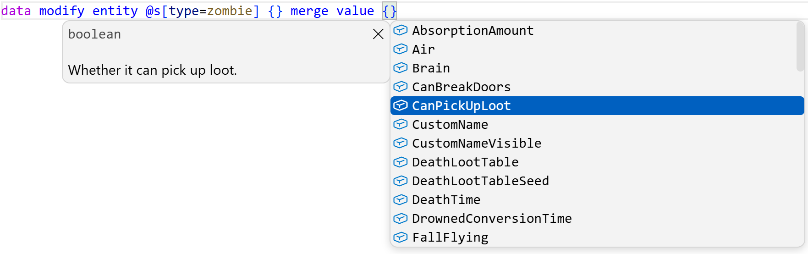

比如此处，mcdoc告诉了大憨批僵尸有哪些NBT标签。如果用户输入了一个不存在的键名，或者用错了数据类型，就会给出诊断信息。

然而很多人不清楚的是，大憨批允许用户创建自己的mcdoc文件，从而为完全自定义的数据结构提供诊断和补全，例如写在`storage`和`custom_data`中的那些。

这是一个非常强大的功能。当你需要处理复杂的数据结构时，mcdoc可以省去一切记住各个键名的担忧，让你在写`data modify storage`时获得和`data modify entity`一样的体验。

此外，在设计新系统之前先使用mcdoc设计它使用的数据格式，非常有助于你有计划地，优雅地，思考并设计新的系统。

### 创建mcdoc

::: tip
我们建议读者新建一个空数据包，一边阅读一边一起尝试。
:::

大憨批现在已经内置了mcdoc语言的高亮等功能，只要安装了大憨批就可以直接开始。

你需要在根目录创建一个`mcdoc`文件夹。所有的`.mcdoc`文件都应该放在这个文件夹中。

同时，建议下载一份[vanilla-mcdoc](https://github.com/SpyglassMC/vanilla-mcdoc)，也就是原版的数据结构。mcdoc允许调用其他文件，包括内置的原版mcdoc文件中的数据结构。

在mcdoc目录中创建一个`example.mcdoc`文件，我们可以开始了。

## 基本类型

::: tip
虽然本文很长，但大部分内容都是进阶格式，实际上很多时候只会用到本文的基础部分。
:::

在mcdoc中，有以下几种基本类型，对应了NBT和JSON中的几种基本类型：

`boolean`, `byte`, `short`, `int`, `long`, `float`, `double`, 和`string`。

想要定义复合标签（或者叫字典）时，使用`struct`关键字。需要给出这个复合标签的名字，以及它包含的键值对。每个键值对用逗号隔开。

比如，定义一个空的复合标签：
```mcdoc
struct EmptyObj{
}
```

定义一个包含了各个基础类型的复合标签：
```mcdoc
struct Primitives{
    myBool: boolean,
    myByte: byte,
    myShort: short,
    myInt: int,
    myLong: long,
    myFloat: float,
    myDouble: double,
    myString: string,
}
```

为了让读者能获得及时的反馈，让我们先来看看mcdoc中的`dispatcher`（可以叫调度器）。\
暂时可以不深入了解它是个什么东西，之后的章节我们会深入探索。

`minecraft:storage`这个调度器可以用来规定storage的数据结构。调度器的键名就是storage的命名空间ID。

比如，我们要求`tut:example`这个storage中包含的数据类型必须符合上面的`Primitives`：

```mcdoc
dispatch minecraft:storage["tut:example"] to Primitives

struct Primitives{
    myBool: boolean,
    myByte: byte,
    myShort: short,
    myInt: int,
    myLong: long,
    myFloat: float,
    myDouble: double,
    myString: string,
}
```
好，保存文件，打开一个函数，写一下`data merge storage tut:example {}`，可以发现大憨批已经在根据我们规定的内容提供补全了。

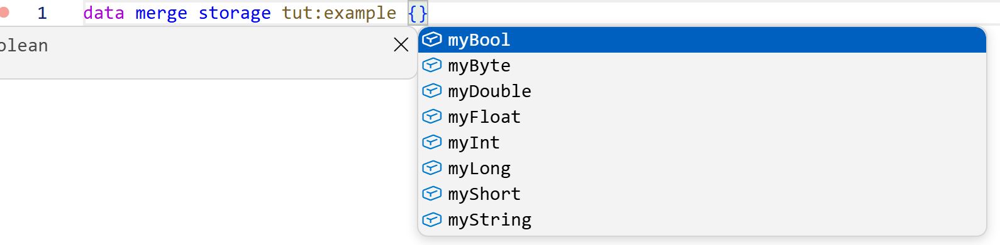
接下来开始介绍mcdoc的语法，让我们从基本类型开始。

### 复合标签

我们可以嵌套复合标签：

```mcdoc
dispatch minecraft:storage["tut:example"] to Primitives

struct Primitives{
    myInt: int,
    myString: string,
    data: Inner,
}

struct Inner{
    value: double
}
```
这个对应了`{myInt: 0, myString: "", data: {value: 0.0d}}`。

`struct`可以内联直接写在里面：

```mcdoc
dispatch minecraft:storage["tut:example"] to struct Primitives{
    myInt: int,
    myString: string,
    data: struct Inner{
        value: double
    },
}
```

可以递归调用自己：
```mcdoc
dispatch minecraft:storage["tut:example"] to struct Primitives{
    myInt: int,
    myString: string,
    data: struct Inner{
        value: Primitives
    },
}
```

也可以匿名：
```mcdoc
dispatch minecraft:storage["tut:example"] to struct{
    myInt: int,
    myString: string,
    data: struct{
        value: double
    },
}
```

除了将一个struct当成一个键名的值，也可以用`...`在另一个struct中直接使用另一个struct中的键值对：
```mcdoc
dispatch minecraft:storage["tut:example"] to struct{
   a: int,
   b: int,
   ...More,
}

struct More{
    c: int,
    d: int,
}
```
这对应了一个`{a:0, b:0, c:0, d:0}`的结构。

当然，这个也可以直接写在里面，也可以匿名：
```mcdoc
dispatch minecraft:storage["tut:example"] to struct{
   a: int,
   b: int,
   ...struct{
        c: int,
        d: int,
    },
}
```

### 列表

在任意数据类型的名称外加上方括号`[]`表示这是一个列表。\
比如，以下是各式各样的列表：
```mcdoc
dispatch minecraft:storage["tut:example"] to struct{
    intList: [int],
    strList: [string],
    objList: [myStruct],
    objList2: [struct{
        value: double
    }]
}

struct myStruct{
    data: int
}
```

### 数组

SNBT中有和列表不同的`byte`, `int`, 和`long`的数组，分别用`byte[]`, `int[]`, `long[]`标识。注意它们和`[byte]`, `[int]`, `[long]`是不同的。

```mcdoc
dispatch minecraft:storage["tut:example"] to struct{
    byte_array: byte[],
    int_array: int[],
    long_array: long[],
}
```

### 任意

`any`可以用来表示任何类型：

```mcdoc
dispatch minecraft:storage["tut:example"] to struct{
    payload: any,
    payload2: [any],
}
```

## 可选

可以在键名和冒号之间加一个问号`?`来表示这个键是可选项，否则就是必选的：
```mcdoc
dispatch minecraft:storage["tut:example"] to struct{
    myString: string,
    myIntOptional?: int,
    dataOptional?: struct{
        value: double,
        flagOptional?: boolean,
    },
}
```
如果必选项不存在，大憨批会报错。

## 数值范围

所有的数值类型，字符串和列表都可以在后面加一个`@ <value>`或`@ <min>..<max>`来限制值的范围。\
数字是限制大小，字符串是限制字符数量，列表限制长度：
```mcdoc
dispatch minecraft:storage["tut:example"] to struct{
    must_be_1?: double @ 1,
    positive?: int @ 1..,
    non_empty_list?: [any] @ 1..,
    str?: string @ 4..9,
    code?: short @ ..10,
    non_empty_list_of_positive?: [int @ 1..] @ 1..,
}
```

这些范围都是包含上下界的。对于`float`和`double`，我们可能会需要不包含上下界的范围，这时可以插入一个小于号`<`：
```mcdoc
@ 1..2
@ 1<..<2
@ 1..<2
@ 1<..2
```

### 字面量

允许直接写字面量，规定这个键只能取这个数值：
```mcdoc
dispatch minecraft:storage["tut:example"] to struct{
    flag: true,
    name: "Dahesor",
    id: 1,
    chance: 0.4f,
    list: ["Dahesor"],
}
```

## 注释

### 代码注释

允许在一行的末端使用两个斜线`//`写注释。注释在mcdoc中是**没有语义**的：
```mcdoc
dispatch minecraft:storage["tut:example"] to struct{
    data?: any,   //让我们来抒发一下感想吧。不知道说什么，还是不说了
}
```

### 文档

如果用三个斜线`///`，那么就是给紧接其后的键值对写的文档。注意这是**有语义**的。\
如果提供了文档，则大憨批会同时提示文档的内容（按Ctrl+Space开关）：
```mcdoc
dispatch minecraft:storage["tut:example"] to struct{
    /// 任何想要保存的数据
    data?: any,
    /// 若为true，则表示数据有效
    valid?: boolean,
}
```
像这样：
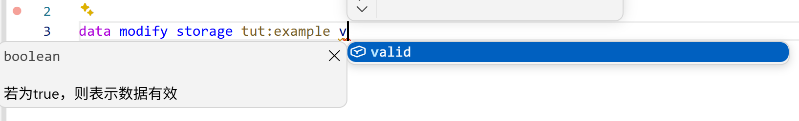

因为它是有语义的，所以不能像注释一样乱写。比如这么写是不合法的，因为它下面没有任何键值对。
```mcdoc
dispatch minecraft:storage["tut:example"] to struct{
    data?: any,
    valid?: boolean,
    /// 我不可以放在这里
    // 但我可以
}
```

## 高级类型

### 元组

若读者不熟悉元组（tuple），简而言之，在SNBT或JSON中，元组是一个长度固定的列表，且列表的每一项都必须是指定的数据类型。

在方括号中写入多个以逗号隔开的数据类型以使用元组。如果元组中只有一个元素，为了和列表区分，需要在末尾加上一个逗号：

```mcdoc
dispatch minecraft:storage["tut:example"] to struct{
    tuple1: [int, string, string, string, double],
    tuple2: [boolean,],
}
```
这里`tuple1`必须是长度为5的列表，且元素必须分别是int, string, string, string, double；`tuple2`必须是只有一个布尔值的列表。

### 枚举

枚举（`enum`）是一系列固定的值的集合，输入值必须是给定的值其中之一。和struct一样，也可以内联或匿名。\
例如：

```mcdoc
dispatch minecraft:storage["tut:example"] to struct{
    item_type: ItemType,
    /// 游戏规则
    gamemode: enum(int){
        survival = 0,
        creative = 1,
        adventure = 2,
        spectator = 3
    }
}

enum(string) ItemType{
    /// 物品
    item = "Item",
    /// 方块
    block = "Block",
}
```

### 并集

并集（union）是多种数据类型的集合，数据可以是其中的任意一种类型。\
要定义并集，只需要把多个数据类型放进`()`中，以`|`隔开：

```mcdoc
dispatch minecraft:storage["tut:example"] to struct{
    item_type: (int | ItemType),
    data?: (short | false | [string]),
}

enum(string) ItemType{
    item = "Item",
    block = "Block",
}
```
这里`data`可以是一个`short`，是字面量`false`，或者是字符串列表。

## 类型别名

可以使用`type`关键字为一个类型创建一个别名，例如
```mcdoc
dispatch minecraft:storage["tut:example"] to struct{
    id?: Index,
    data?: DataType,
}
type Index = int
type DataType = (short | false | [string])
```

### 泛型

`type`允许写尖括号`<>`来使用泛型。使用时必须同时传一个数据类型：

```mcdoc
dispatch minecraft:storage["tut:example"] to struct{
    /// 长度为3的int列表
    intlist: ListOf3<int>,
    /// 长度为3的字符串列表
    stringlist: ListOf3<string>,
    /// 长度为3的正数double列表
    PositiveDoubleList: ListOf3<double @ 0<.. >
}

type ListOf3<T> = [T] @ 3
```

需要多个类型则用逗号隔开，比如`type MyType<T, P>`。

## 动态键名

键名除了是写死的字面量，也可以引用任意的类型。
```mcdoc
dispatch minecraft:storage["tut:example"] to struct{
    [food]?: double,
    [meat]?: double,
}

type food = ("apple" | "carrot" | "bread")
type meat = enum(string){
    pork = "pork",
    beaf = "beaf",
}
```
此处键名可以是`apple`, `carrot`, `bread`, `pork`, 和`beaf`。\
如果写`[any]?: any`即为任意键都可以是任意类型，也就和没有定义没区别了。

## 引用

`use`关键字可以把其他文件中的定义导入到当前文件。\
例如，将原版mcdoc中的文本组件定义导入进来并使用：
```mcdoc
use::java::util::text::Text

dispatch minecraft:storage["tut:example"] to struct{
    text?: Text
}
```

实际上，不导入也可以直接按完整路径使用：
```mcdoc
dispatch minecraft:storage["tut:example"] to struct{
    text?: ::java::util::text::Text
}
```

除此之外，可以用`as`在引入时改个名字：
```mcdoc
use::java::util::text::Text as VanillaText

dispatch minecraft:storage["tut:example"] to struct{
    text?: VanillaText
}
```

### 路径

上文中使用了`::java::util::text::Text`这个路径。读者可以自行去`vanilla-mcdoc`中寻找原版提供的所有数据结构。\
路径使用`::`进入文件夹，或者选中文件中的一个定义。例如，上例中的文件路径是`java/util/text.mcdoc`，而这个文件中定义了`type Text = ...`。

特别地，`mod.mcdoc`这个文件的路径被视为不包含`mod`，换言之，`java/path/mod.mcdoc`的路径是`::java::path`而不是`::java::path::mod`。这个路径和`java/path.mcdoc`的路径一样，但给了你更干净地整理文件夹的方式。

注意我们在最前面也写了一个`::`，如果不写最前面的冒号，则这个路径被视为相对路径，而不是从根目录解析的绝对路径。\
`super`可以用来上移一层路径，例如`use super::`。

例如，在`java/path.mcdoc`或`java/path/mod.mcdoc`中写`use filename::Types`会引入`java/path/filename.mcdoc`中的`Types`定义。\
而写`use super::folder::Types`则会引入`java/folder.mcdoc`或`java/folder/mod.mcdoc`中的`Types`定义。

我们在最开始要求读者把所有的mcdoc文件都放进根目录的mcdoc文件夹下，因为大憨批会把这个文件夹当成mcdoc的根目录。不过有时可能会出现bug，这点我们在后面的**错误排查**章节讨论。

在**常用引用**章节，我们会列举一些原版mcdoc规定好的常用数据结构的路径，以供读者快速查阅。

## 属性

属性是mcdoc中可以给键值对的额外信息，可以定义该键值对的额外行为，比如值必须符合某种格式，只有在某版本后可用等等。\
属性的格式是`#[属性名]`。

可以放在键值对的上面，对键名施加属性，或者放到冒号`:`和值的中间，对值施加属性：
```mcdoc
struct{
    // 给value添加的属性
    #[attr]
    value?: int,
    // 给int添加的属性
    score?: #[attr] int,
}
```
部分属性还可以提供可选或必选的参数，如果只有一个参数可以直接写`#[属性名=<参数>]`，如果有多个则需要写`#[属性名(<参数名>=<参数>,<参数名>=<参数>)]`。

如果要施加多个属性，并列写即可：`#[attr1] #[attr2]`。

### 命令

**`command`属性需要值必须是一条命令**，例如：
```mcdoc
dispatch minecraft:storage["tut:example"] to struct{
    command?: #[command] string,
}
```
可以看到大憨批会提供命令的补全：
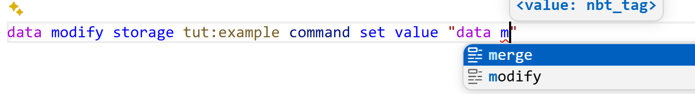

**它可以接受以下可选参数**：
 - `slash`：是否需要最前面的斜线`/`。可以为`allowed`（加不加都可以），或`chat`（不加视为聊天信息）。不存在时则不允许斜线。
 - `incomplete`：是否允许命令不完整（比如`suggest_command`中）。可以为`allowed`（允许），不存在时不允许。
 - `empty`：是否允许是空的（比如设置命令方块的命令）。可以为`allowed`（允许），不存在时不允许。
 - `max_length`：命令的最大长度。不存在时没有限制。
 - `macro`：控制命令宏参数。可以为`implicit`（不写最前面的`$`也需要有宏参数，例如对话框中），不存在时不允许使用宏。

```mcdoc
dispatch minecraft:storage["tut:example"] to struct{
    macro_command: #[command(macro="implicit")] string,
    empty_command_slashable: #[command(slash="allowed", empty="allowed")] string,
}
```

**`entity`属性需要值必须是一个选择器**。它可以接受两个可选参数：
 - `type`，可以是`entities`（实体选择器），或`players`（玩家选择器）。
 - `amount`，选择器可以选择的实体数量，可以是`multiple`（多个）或`single`（单个）。

```mcdoc
dispatch minecraft:storage["tut:example"] to struct{
    selector?: #[entity] string,
    player?: #[entity(type=players)] string,
    single_entity?: #[entity(type=players, amount=single)] string,
}
```
然而实际上，大憨批只支持对`amount`属性的检查。`type`即使提供了也不会检查。

**`objective`属性需要值必须是一个记分板ID**。\
**`score_holder`属性需要值必须是一个分数持有者**。\
**`tag`属性需要值必须是一个标签**。\
**`team`属性需要值必须是一个队伍**。\
**`url`属性要求值必须是URL**。\
**`uuid`属性要求值必须是合法的UUID**。

```mcdoc
dispatch minecraft:storage["tut:example"] to struct{
    objective?: #[objective] string,
    name?: #[score_holder] string,
    tag?: #[tag] string,
    team?: #[team] string,
    url?: #[url] string,
    /// 十六进制连字符UUID
    UUID?: #[uuid] string,
    /// 整型数组UUID
    UUIDArray?: #[uuid] int[] @ 4,
}
```
大憨批也都会提供对应的补全。

### 颜色

**`color`属性要求值必须是一个颜色**，一共有以下几种选择：
```mcdoc
dispatch minecraft:storage["tut:example"] to struct{
    color?: (
        // 三个小数表示的RGB
        #[color="dec_rgb"] [float] @ 3 |
        // 一个数字表示的RGB
        #[color="composite_rgb"] int |
        // 以`#`打头的十六进制颜色
        #[color="hex_rgb"] string |
        // 四个小数表示的RGBA（带透明度）
        #[color="dec_rgba"] [float @ 0..1] @ 4 |
        // 一个数字表示的RGBA（带透明度）
        #[color="composite_argb"] int
        // 以#打头的十六进制颜色，带透明度
        #[color="hex_argb"] string |
        // 字符串表示的16个标准颜色之一，比如red
        #[color="named"] string |
    )
}
```
大憨批会在带有这种属性的值旁边加上颜色选择器。

### 整除

**`divisible_by`属性需要数值可以被提供的参数整除**：

```mcdoc
dispatch minecraft:storage["tut:example"] to struct{
    /// 必须被4整除
    group?: #[divisible_by=4] int,
}
```

### 弃用

**`deprecated`属性标注这个键已被弃用**。注意该属性需要添加给键名而不是值。
```mcdoc
dispatch minecraft:storage["tut:example"] to struct{
    /// 已弃用，请使用`amount`。
    #[deprecated]
    value: int,
    amount: int,
}
```
大憨批会在提示时标注删除线：
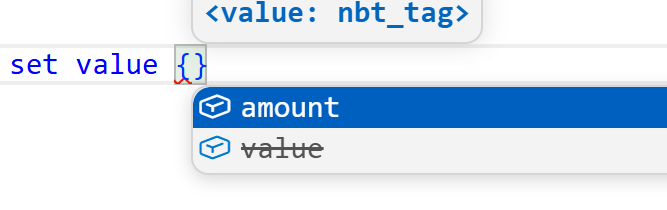

此外还可以注释是在哪个版本弃用的，比如`#[deprecated="1.21"]`。

### 命名空间ID

**`id`属性标注值必须是一个命名空间ID的形式**，并把没有命名空间的值视为`minecraft`，且会在NBT检查或路径中禁止省略命名空间：
```mcdoc
dispatch minecraft:storage["tut:example"] to struct{
    id: #[id] string,
}
```

它可以接受一个参数，表示该ID所属的注册表，例如：
```mcdoc
dispatch minecraft:storage["tut:example"] to struct{
    function: #[id=function] string,
    item: #[id=item] string,
}
```
这时大憨批就会提示该命名空间下已经存在的注册表项：
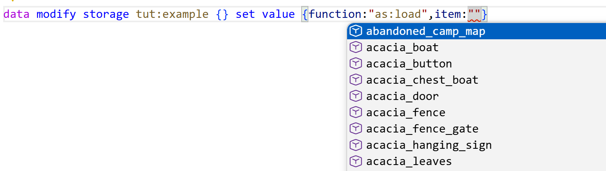
而且Ctrl+点击可以跳转到对应的定义项。

但实际上它还可以接受更多参数！包括：
 - `registry`：该ID所属的注册表，也就是上面只提供一个参数时提供的对象。
 - `tags`：是否允许标签，可以是`allowed`（可以），`required`（必须是标签），或`implicit`（必须是标签且不加`#`）。如果不提供这个属性那就是不允许标签。
 - `path`：定义路径从哪个文件夹开始算。
 - `prefix`：允许在ID之前添加提供的字符。
 - `exclude`：列表。不允许使用的ID。
 - `definition`：可以是`true`或`false`（默认）。如果提供的ID不存在，是否定义这个ID。

示例：
```mcdoc
dispatch minecraft:storage["tut:example"] to struct{
    /// 函数，可以是函数标签
    function: #[id(registry="function", tags="allowed")] string,
    /// 物品使用的模型，从item路径开始算
    model: #[id(registry="model", path="item/")] string,
    /// 物品，但不可以是air
    item: #[id(registry="item", exclude=["air"])] string,
    /// 物品组件，且可以写成`!<物品组件>`的形式
    components: #[id(registry="data_component_type", prefix="!")] string
}
```

**让我们着重研究一下`definition`**。

先试着给原版的注册表加`definition`：
```mcdoc
dispatch minecraft:storage["tut:example"] to struct{
    /// 定义更多物品
    items: [#[id(registry="item",definition=true)] string],
}
```
这里我们定义了`items`键为字符串列表，且可以作为新ID的定义，可以发现写在这个列表中的ID出现在了`give`命令的列表中：
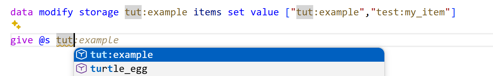

但不止！我们可以定义自己的注册表并往里面加入ID：
```mcdoc
dispatch minecraft:storage["tut:example"] to struct{
    /// 定义我们的技能
    skills: [#[id(registry="dahesor:skill",definition=true)] string],
    /// 使用我们的技能
    using: #[id="dahesor:skill"] string
}
```
可以看到我们自己的注册表内容被提示了：
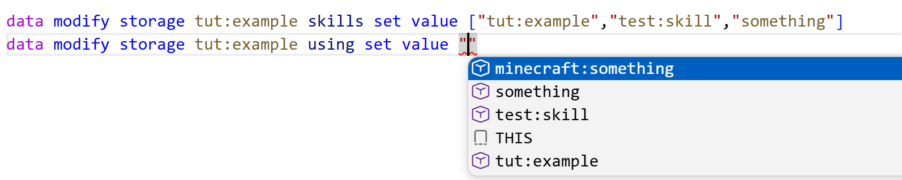

注意`something`由于没有命名空间，所以被当成了`minecraft`。因此为了避免可能出现的漏洞，如果读者想用这个技巧，应该总是定义带命名空间的ID。

### 正则

**`regex_pattern`属性要求值必须是一个正则表达式**。\
**`match_regex`属性要求值必须符合提供的正则表达式**。\
注意这两个东西不一样。
```mcdoc
dispatch minecraft:storage["tut:example"] to struct{
    regex?: #[regex_pattern] string,
    digits?: #[match_regex="[0-9]+"] string,
}
```

### 版本标注

**`since`和`until`属性对键施加，规定该键在哪个版本之后或之前才存在**，必须提供一个版本作为参数：
```mcdoc
dispatch minecraft:storage["tut:example"] to struct{
    // 26.3之后，使用type
    #[since="26.3"]
    type?: #[id="loot_condition_type"] string,
    // 26.3之前，使用condition
    #[until="26.3"]
    condition?: #[id="loot_condition_type"] string,
}
```

### SNBT

**`nbt`属性要求值必须是一个字符串形式的SNBT**，例如`"{id:\"apple\"}"`。可以提供参数以规定要符合的数据类型，不过这个参数现在不受支持。\
**`nbt_path`属性要求值必须是一个NBT路径**。然而这个属性也不被支持，暂时用不了。

```mcdoc
dispatch minecraft:storage["tut:example"] to struct{
    nbt: #[nbt=NBTData] string,
}

struct NBTData{
    value?: double,
}
```

### 默认形式

**在一个并集中，如果有一个数据类型有`canonical`属性，则在尝试检查或读取这个NBT时则总是使用这个数据类型**。\
可以参考展示实体的渲染变换。尽管我们有3种定义的方式，但游戏总会以四元数复合标签的形式保存。
```mcdoc
dispatch minecraft:storage["tut:example"] to struct{
    color?: (
        #[canonical] #[color="composite_rgb"] int |
        #[color="dec_rgb"] [float] @ 3 |
        #[color="hex_rgb"] string |
    )
}
```

### 其他

- `translation_key`属性要求值必须是一个翻译键。和命名空间类似，也可以使用`definition`以在不存在时定义翻译键。
- `pack_format`属性要求值必须是一个pack.mcmeta中的版本号。
- `time_pattern`属性要求值必须是一个时间格式，比如`yyyy-MM-dd`或`HH:mm:ss`。
- `integer`属性施加给string时，要求这个字符串必须是一个整数，且可以提供`min`和`max`属性规定范围。
- `text_component`属性要求string必须是字符串保存的JSON文本组件，也就是1.21.4之前的老格式。
- `criterion`可以定义和使用进度准则，基本用不到，不多赘述。

## 调度器

调度器可以根据不同的值使用不同的数据结构。参考文本组件的`click_event`，在`action`是`run_command`时需要提供`command`，而是`open_url`则需要提供`url`。

写一下上述的结构：

```mcdoc
dispatch minecraft:storage["tut:example"] to struct{
    action: ("run_command"|"open_url"),
    ...dahesor:action_type[[action]]
}

dispatch dahesor:action_type[run_command] to struct{
    command: #[command] string
}

dispatch dahesor:action_type[open_url] to struct{
    url: #[url] string
}
```

我们定义了一个新的调度器，ID是`dahesor:action_type`。它会读取`action`的值作为**调度键**，根据不同的值使用不同的内容。\
注意三个点`...`。前面说过，是直接使用键值对。所以当然也可以写：
```mcdoc
dispatch minecraft:storage["tut:example"] to struct{
    action: ("run_command"|"open_url"),
    data: dahesor:action_type[[action]]
}
```
这样就成了`{action:"run_command",data:{command:"say 1"}}`的格式。

注意`[action]`相当于上面说过的动态键名。如果不加`[]`，那么就会根据写死的值查阅调度器：
```mcdoc
dispatch minecraft:storage["tut:example"] to struct{
    action: ("run_command"|"open_url"),
    ...dahesor:action_type[run_command]
}

dispatch dahesor:action_type[run_command] to struct{
    command: #[command] string
}

dispatch dahesor:action_type[open_url] to struct{
    url: #[url] string
}
```
这样无论如何都会提示command。

### 内置和提供的调度器

现在是时候看看我们写了好久的`dispatch minecraft:storage["tut:example"]`了，没错，这相当于大憨批留下来的接口，按照storage的ID调度到不同的数据类型。

可以发现，调度器一旦定义就是**全局**的，不像是`struct`之类，如果来自其他文件就必须先`use`。

一些其他的接口：
 - `mcdoc:custom_data`：这是预留的`custom_data`中的调度器，可以定义物品组件`custom_data`或实体`data`数据下的内容，比如：

```mcdoc
dispatch mcdoc:custom_data["flag"] to boolean
dispatch mcdoc:custom_data["info"] to struct {
    score?: int,
    value?: double,
}
```
可以看到补全：
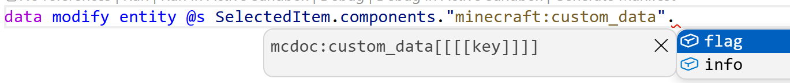

 - `minecraft:resource`：相当于是各种JSON定义的根调度器，比如`dispatch minecraft:resource[predicate]`或`dispatch minecraft:resource[recipe]`。我们暂时略过不说。

### 调度struct

除了调度器可以这样调度，其实struct也可以。类似这样：
```mcdoc
dispatch minecraft:storage["tut:example"] to struct{
    action: ("run_command"|"open_url"),
    ...ActionType[[action]]
}

struct ActionType{
    run_command?: struct{
        command: #[command] string
    },
    open_url?: struct{
        url: #[url] string
    },
}
```
对比调度器，它不是全局的，且没有那么容易管理。\
并且，一旦写死其他人也无法加入新的调度选项（在支持inject之前），例如，只要写
```mcdoc
dispatch minecraft:click_event[my] to struct{
    data: int,
}
```
就可以给文本的`click_event`加一个调度器（因为vanilla-mcdoc内部定义了这个调度器），而使用struct则做不到。

### 回落情况

`%fallback`调度键无需定义，会被mcdoc自动生成，是所有情况的并集：
```mcdoc
dispatch minecraft:storage["tut:example"] to struct{
    events?: minecraft:click_event[%fallback]
}
```
可以看到所有的情况都被提示了：
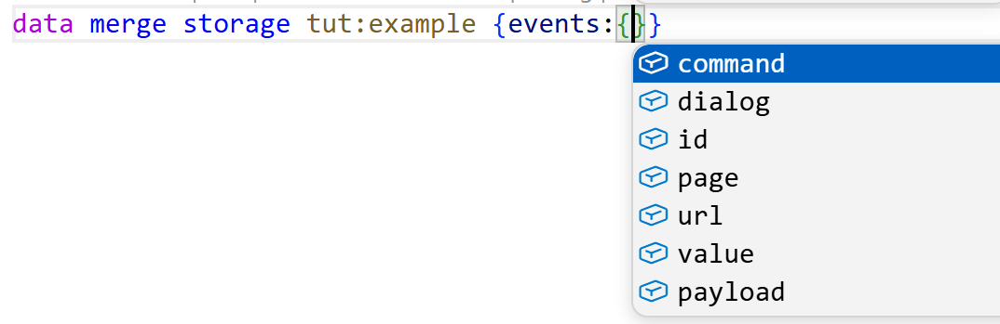

### 空调度键

`%none`是没有给调度器提供ID的情况：
```mcdoc
dispatch minecraft:storage["tut:example"] to struct{
    action: string,
    ...dahesor:action_type[[action]]
}

dispatch dahesor:action_type[%none] to struct{
    data: any,
}

dispatch dahesor:action_type[run_command] to struct{command: #[command] string}
dispatch dahesor:action_type[open_url] to struct{url: #[url] string}
```
在我们不写`action`的时候就会提示`data`，但一旦提供了`action`就不再会提示`data`，即使不是`run_command`或`open_url`之一。

### 未知调度键

如果提供了没有定义的调度键，就会使用`%unknown`定义的情况。
```mcdoc
dispatch minecraft:storage["tut:example"] to struct{
    action: string,
    ...dahesor:action_type[[action]]
}

dispatch dahesor:action_type[%unknown] to struct{
    data: any,
}

dispatch dahesor:action_type[run_command] to struct{command: #[command] string}
dispatch dahesor:action_type[open_url] to struct{url: #[url] string}
```
如果`action`不是`run_command`或`open_url`之一就会提示`data`。\
如果没有定义`%none`，那么在不提供`action`时也会提示`data`，因为这时`%none`这个调度键没有被定义，所以也会使用`%unknown`。

### 动态键名调度键

可以使用`%key`表示使用该键值对的键名作为调度键，比如：
```mcdoc
dispatch minecraft:storage["tut:example"] to struct{
    [string]: dahesor:action_type[[%key]]
}

dispatch dahesor:action_type[run_command] to struct{command: #[command] string}
dispatch dahesor:action_type[open_url] to struct{url: #[url] string}
```
这里我们的键名是run_command，所以就会使用它作为调度键：
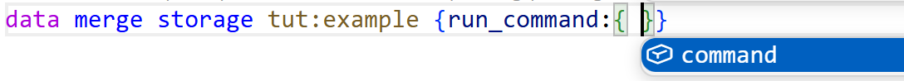

### 调度器属性

上面说的属性中，还有一个是`dispatcher_key`。它需要一个参数提供调度器的ID，以要求值必须是该调度器的一个键。\
我们可以通过该属性完善**动态键名调度键**章节中的示例：
```mcdoc
dispatch minecraft:storage["tut:example"] to struct{
    [#[dispatcher_key="dahesor:action_type"] string]: dahesor:action_type[[%key]]
}

dispatch dahesor:action_type[run_command] to struct{command: #[command] string}
dispatch dahesor:action_type[open_url] to struct{url: #[url] string}
```
这样即使键名是动态的`[string]`，大憨批也会提示可能的`run_command`或`open_url`。

### 使用子节点

和NBT路径类似，可以使用`.`来进入子节点：
```mcdoc
dispatch minecraft:storage["tut:example"] to struct{
    content: struct{
        action: ("run_command"|"open_url"),
    },
    ...dahesor:action_type[[content.action]]
}

dispatch dahesor:action_type[run_command] to struct{command: #[command] string}
dispatch dahesor:action_type[open_url] to struct{url: #[url] string}
```

### 使用父节点
使用`%parent`来向上移动一层：
```mcdoc
dispatch minecraft:storage["tut:example"] to struct{
    action: ("run_command"|"open_url"),
    content: struct{
        ...dahesor:action_type[[%parent.action]]
    }
}

dispatch dahesor:action_type[run_command] to struct{command: #[command] string}
dispatch dahesor:action_type[open_url] to struct{url: #[url] string}
```
也可以套娃：
```mcdoc
dispatch minecraft:storage["tut:example"] to struct{
    [string]: struct{
        content: struct{
            ...dahesor:action_type[[%parent.%parent.%key]]
        }
    }
}

dispatch dahesor:action_type[run_command] to struct{command: #[command] string}
dispatch dahesor:action_type[open_url] to struct{url: #[url] string}
```

### 连续调度

调度器可以深入多层数据结构：
```mcdoc
dispatch minecraft:storage["tut:example"] to struct{
    action: "open_url",
    type: ("url"|"file"),
    ...dahesor:action_type[[action]][[type]]
}

dispatch dahesor:action_type[open_url] to struct{
    url?: struct{
        url: #[url] string
    },
    file?: struct{
        path: string
    }
}
```
根据`action`和`type`的不同会选中不同的情况。

### 并列调度

如果有多个调度键的结果一样，可以用`,`隔开来写在一起：
```mcdoc
dispatch minecraft:storage["tut:example"] to struct{
    action: ("run_command"|"open_url"),
    ...dahesor:action_type[[action]]
}

dispatch dahesor:action_type[open_url, run_command] to struct{
    data?: string
}
```
这里`run_command`和`open_url`情况相同。


## 注入

标准中规定了`inject`关键字可以向struct或enum中注入新的键值对，但大憨批暂时并不支持这么使用，因此这里不探讨。

## 常用引用

- `use ::java::util::text::Text`：1.21.5+的文本组件
- `use ::java::world::component::CustomData`：物品的`custom_data`和实体的`data`
- `use ::java::world::item::ItemStack`：物品堆
- `use ::java::util::slot::SlottedItem`：带槽位的物品堆，注意这是泛型
- `use ::java::data::dialog::Dialog`：对话框结构
- `use ::java::world::entity::mob::EntityEquipment`：生物的`equipment`

这里只列举了寥寥几个，有需要应该自行在vanilla-mcdoc中翻找。

## 错误排查

如果大憨批的符号补全出现异常，可以尝试让其（按下F1，或Ctrl+P后输入`>`）执行`>Spyglass: Reset Prolect Cache`，再重启VS Code。

有时，这也无法解决全部问题。此时请你执行`>Spyglass: Reset Prolect Cache`，这会打开缓存文件夹。这时关掉VS Code，删掉弹出的文件夹中的`symbols`文件夹，再重启VS Code即可。

目前，mcdoc的路径有些问题。正常来说，在根目录下的mcdoc文件夹会被当成跟目录。也就是说`mcdoc/dir/this.mcdoc`的路径理应是`::dir::this`。然而，在你进行了上述符号清理后，`mcdoc`有可能会变成路径的一部分，也就是`::mcdoc::dir::this`。在该漏洞修复之前，出现这种情况只需要更改所有引用路径即可。

## 参考

如果你感兴趣，可以仔细阅读：
- 原版mcdoc：[https://github.com/SpyglassMC/vanilla-mcdoc](https://github.com/SpyglassMC/vanilla-mcdoc)
- Mcdoc格式标准：[https://spyglassmc.com/user/mcdoc/specification](https://spyglassmc.com/user/mcdoc/specification)