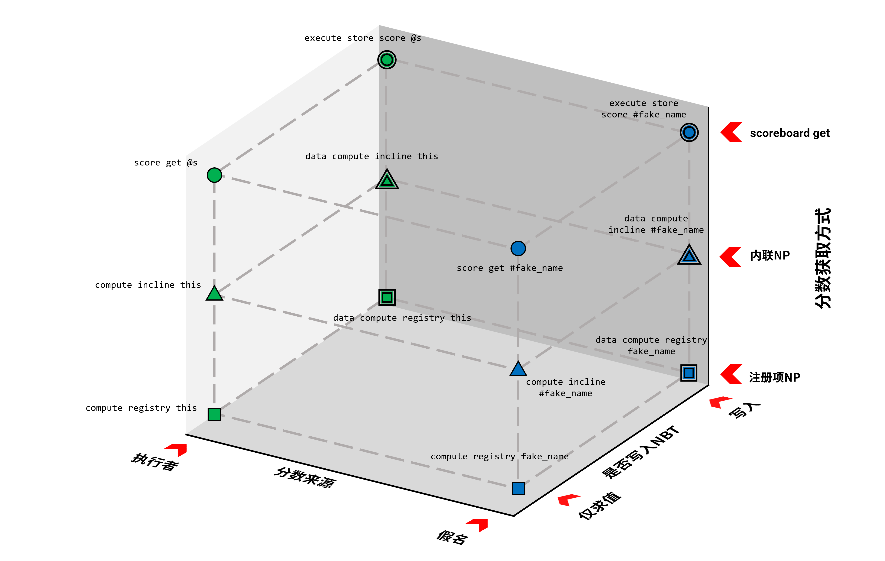
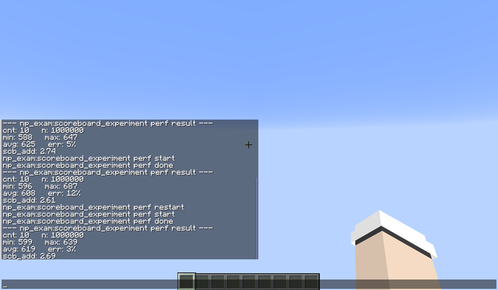
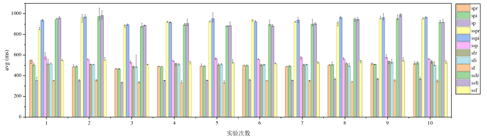
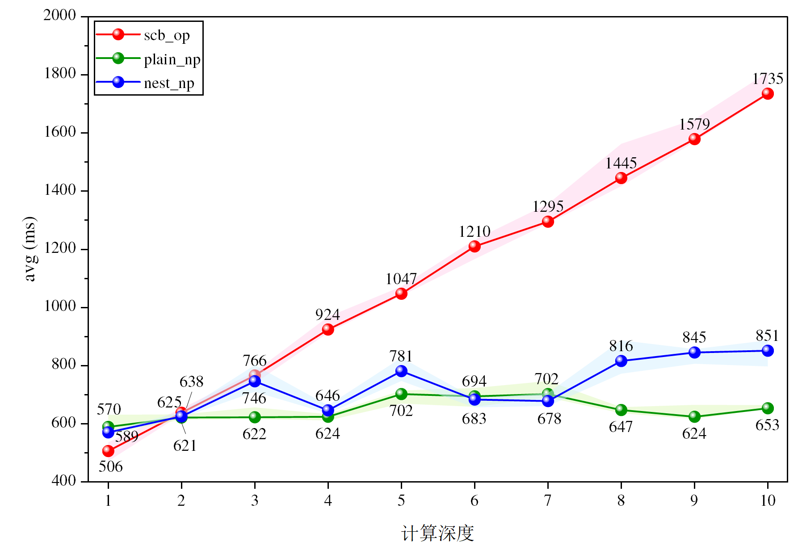
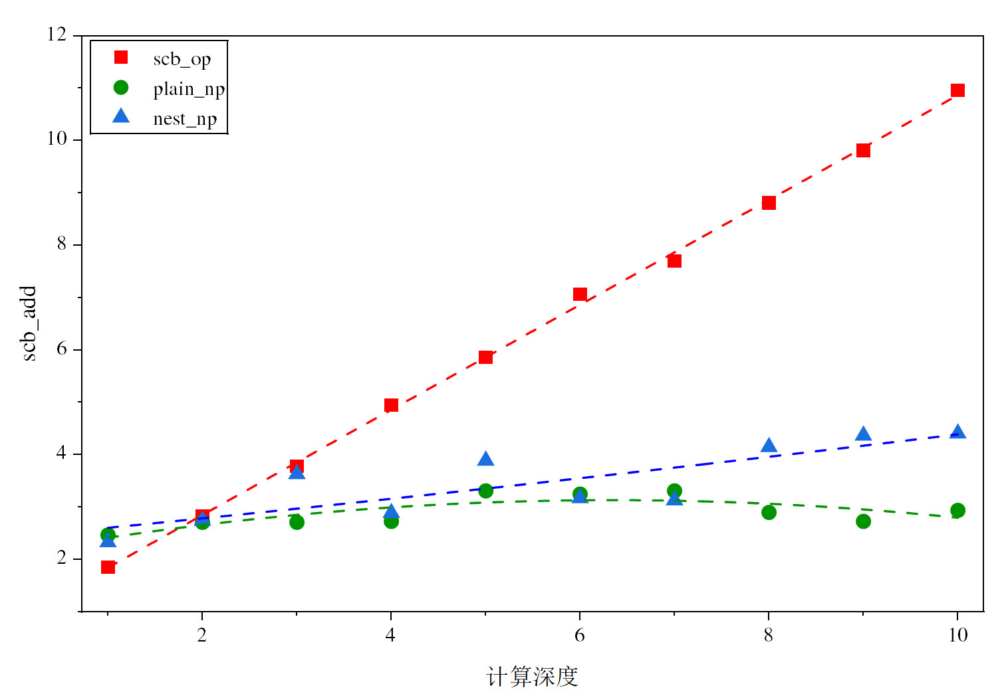

<script setup>
import ns from '/.vitepress/vue/nbt/namespace.vue'
import obj from '/.vitepress/vue/nbt/object.vue'
import list from '/.vitepress/vue/nbt/list.vue'
</script>
<FeatureHead
  title="数值提供器的性能边界：26.3 中数据存取与计算性能测试"
  authorName="徐木弦"
  :extraAuthors="['小豆8593']"
  cover="../_assets/1.png"
/>

## 摘要

26.3 对数值提供器进行了大幅扩展，使其能够通过<cmd c="compute"/>，<cmd c="data"/>等命令参与数据传递与数值计算。数值提供器在功能上可以部分替代传统的记分板运算、<cmd c="random"/>以及部分控制流实现，但功能上的替代关系并不意味着性能上的替代关系。本文使用小豆所开发的 Perf 1.4 数据包，在 Minecraft 26.3 环境下分别对记分板分数转存为命令存储数据以及 NP 数值计算两类场景进行性能测试。

## 1. 引言

::: tip 约定
下文中，简称数值提供器为 NP
:::

26.3 对于数据包领域是一个破坏性更改较严重的版本，其破坏主要集中于谓词系统，进而影响进度、战利品表、物品修饰器和魔咒等依赖谓词的内容。不过，26.3 并非是完全破坏性的版本，它还强化了数值提供器，使之成为可写注册表，使部分游戏行为能够被 NP 控制。

先前 NP 只能在战利品表系统内部使用，作用范围有限；从 26.3 起，NP 提供的值可经由<cmd c="compute"/>，<cmd c="data"/>等命令输出到其他媒介。这意味着游戏增加了一些数据转存的手段。\
以分数转存为命令存储数据为例，之前通用的方法为：

```mcfunction
execute store result storage ... run scoreboard players get ...
```

但现在，类型为 `score` 的 NP 可以返回分数，从 26.3 起配合<cmd c="data ... compute"/>可直接将分数传入命令存储：

```mcfunction
data modify storage ... set compute default integer {score:"...",target:{...},type:"minecraft:score"}
```

随机数生成的功能也可以由 NP 实现，例如：

```mcfunction
compute default integer {max:100,min:1,type:"minecraft:uniform"}
```

像这样使用均匀分布随机数的整数提供器，除了无法控制随机序列以外，可以做到和<cmd c="random"/>一样的效果。\
除此之外，新 NP 还可以部分代替像<cmd c="execute if"/>这样的控制流语句。`conditional`类型的 NP 可以直接用于实现 if-else 语句，而`number_dispatcher`类型则可以实现`switch`-`break`效果。\
以往的控制流语句通常需要开发者在函数内书写一长串<cmd c="execute if"/>，如果将其合并到一个 NP 内，可以大幅度减小命令链长度。

从 NP 本身功能的角度来说，新 NP 还提供了包括但不限于四则运算、绝对值、算术平方根、幂运算、三角函数在内的很多种初等运算。

在 26.3 以前，用数据包实现计算通常使用的是<cmd c="scoreboard players operation"/>，这个模块只能用于计算整数，且涉及的运算只有四则运算、求余、赋值、取较大或较小值、交换。

之前，如果要计算浮点数，开发者会将原数据缩放一定倍率，以整数形式放到记分板中。当然也有其他使用非记分板实现部分计算的方式。\
例如，可以生成展示实体，将被除数写为<list t="transformation" />矩阵形式主对角线上的前三个元素，除数写为最后一个元素，应用修改后<list t="transformation.scale" />即是除法运算的结果。

引入新的 NP 之后，数据包即有了对浮点数计算、更多初等运算的直接支持，从表面上看似乎会对传统记分板运算造成不小冲击。

然而，功能上的替代关系并不意味着性能上的替代关系。NP 与记分板虽然都可以完成部分数值计算和数据传递，但二者的执行机制、数据类型以及命令调用方式并不相同。因此，对于数据包开发者而言，一个更实际的问题并不是“NP 能否实现原本由记分板完成的功能”，而是在实际使用中，什么样的任务适合交给 NP，什么样的任务仍然适合使用记分板。

本文主要从两个具有代表性的场景对这一问题进行测试。首先，针对数据转存这一 26.3 中较为重要的新用途，比较传统的<cmd c="execute store"/>与 NP 直接获取记分板值的方式，考察 NP 是否能够在数据转存场景中替代原有的命令组合。其次，针对 NP 新增的计算能力，通过逐渐增加计算量的方式测试 NP 与传统记分板运算的执行性能，以观察计算规模对两种方案性能差异的影响。

## 2. 实验设计

本研究使用 [Perf 数据包](https://github.com/xiaodou8593/perf_1.4) 以测试性能，其版本号 1.4，开发者为 [小豆 8593](https://github.com/xiaodou8593)。实验环境如下表所示：

**表 1：测试环境**
| 变量 | 参数 |
| --- | --- |
| CPU | i7-14650HX |
| GPU | GeForce RTX 4060 |
| Java 版本 | 25.0.1 |
| 游戏版本 | 26.3 |

### 2.1 实验内容

研究设计了两个实验：**记分板分数转存为命令存储数据性能实验** 和 **NP 计算性能实验**。对于前者，笔者一共设计了 12 条用于测试的命令，由于部分命令的开销过小，故每条命令在一次测试中运行 1000000 次，各自测试 10 遍。这 12 条命令为：

**表 2：记分板分数转存为命令存储数据性能实验**
| 实验组编号 | 命令 |
| --- | --- |
| spr |<cmd c="compute default integer np_exam:get_player_score"/>|
| spi |<cmd c='compute default integer {score:"bench",target:"this",type:"minecraft:score"}'/>|
| sp |<cmd c="scoreboard players get @s bench"/>|
| sspr |<cmd c="data modify storage bench:test new set compute default integer np_exam:get_player_score"/>|
| sspi |<cmd c='data modify storage bench:test new set compute default integer {score:"bench",target:"this",type:"minecraft:score"}'/>|
| ssp |<cmd c="execute store result storage bench:test old int 1 run scoreboard players get @s bench"/>|
| sfr |<cmd c="compute default integer np_exam:get_fake_name_score"/>|
| sfi |<cmd c='compute default integer {score:"bench",target:{name:"#fake_name",type:"minecraft:fixed"},type:"minecraft:score"}'/>|
| sf |<cmd c="scoreboard players get #fake_name bench"/>|
| ssfr |<cmd c="data modify storage bench:test new set compute default integer np_exam:get_fake_name_score"/>|
| ssfi |<cmd c='data modify storage bench:test new set compute default integer {score:"bench",target:{name:"#fake_name",type:"minecraft:fixed"},type:"minecraft:score"}'/>|
| ssf |<cmd c="execute store result storage bench:test old int 1 run scoreboard players get #fake_name bench"/>|

实验从三个维度综合对比了这些写法的性能：一是对比用 NP 获取分数和用 `/scoreboard` 直接获取分数这两种形式，同时还设计了内联形式和 JSON 注册项形式的对比；二是对比仅求值和将值写入 NBT 的情况；三是对比分数来源为上下文内的执行者和假名的情况。


**图 1：实验维度设计**

第二套实验测试了 NP 运算功能和记分板运算模块的性能，实验设置三种受试命令。第一种为传统记分板运算模块：

```mcfunction
scoreboard players operation #result bench += #add bench
```

第二种为将多个加数直接放入同一个 NP 中的扁平 NP：

```mcfunction
compute default integer {inputs:[1,1,1],type:"minecraft:add"}
```

第三种为通过 NP 嵌套实现连续计算的嵌套 NP：

```mcfunction
compute default integer {inputs:[1,{inputs:[1,1],type:"minecraft:add"}],type:"minecraft:add"}
```

三种方案均用于实现连续加法，区别在于计算过程的组织方式。记分板方案通过多次执行<cmd c="scoreboard players operation"/>完成连续运算；扁平 NP 将多个操作数置于同一个 add 提供器中；嵌套 NP 则通过提供器之间的嵌套关系构造计算树。

实验的自变量为计算深度，即连续加法中包含的运算层数。为便于定义，设最基本的 $1+1$ 为 1 层计算，则 $1+1+1$ 为 2 层，$1+1+1+1$ 为 3 层，以此类推。换言之，若表达式包含 $(n+1)$ 个 1，则其计算深度为 $n$。

实验测试计算深度 1 ~ 10。对于每一个计算深度，均构造具有相同数学结果的计算任务，并分别采用上述三种方式执行，从而比较在计算量逐渐增加的情况下三种实现方式的性能变化。每种各测试 1000000 次。

### 2.2 实验过程

[Perf 数据包](https://github.com/xiaodou8593/perf_1.4) 允许用户在自己的数据包内测试性能，测试在专用数据包内的命名空间<ns t="np_exam"/>下进行。在该命名空间内的 `function` 文件夹下按住 Shift 点鼠标右键，运行 Powershell，执行 `pip3 install mcf-mot`。以上为初次执行前安装数据包的步骤，若已安装完成，则只需要在命名空间 `function` 文件夹下运行 Powershell。

以 spr 实验组为例，接下来依次执行：

```
mot
push perf_folder
run
creisp spr/_start*
stop
pop
```

至此 `function` 文件夹内会出现以下结构：

<div class="nbttree">

📂 function
- 📂 spr
  - 📄 _print.mcfunction
  - 📄 _start.mcfunction
  - 📄 loop.mcfunction

</div>

将<ns t="np_exam:spr/_start"/>函数的内容修改为：

```mcfunction
#> np_exam:spr/_start
# 开始模板测试

# 设置为文件夹名
data modify storage perf:io testing set value "np_exam:spr"

# 设置测试环境(例如在这里设置实体数量)
scoreboard players set @a bench 1
tag @e remove test_as_entity
tag Mu_xian add test_as_entity

# 设置开始测试延后时间(防止上一步消耗过大使tps波动)
scoreboard players set perf_start int 10

# 设置测试次数(测试多少个tick)
scoreboard players set perf_cnt int 10

# 设置单次测试递归次数(值必须整除10000000)
scoreboard players set perf_n int 1000000
```

函数<ns t="np_exam:spr/loop"/>的内容修改为：

```mcfunction
#> np_exam:spr/loop

# 在这里写测试命令
compute default integer np_exam:get_player_score

scoreboard players remove perf_loop int 1
execute if score perf_loop int matches 1.. run function np_exam:spr/loop
```

以相同方式创建记分板分数转存为命令存储数据性能实验的其他 11 个受试命令，然后在 Powershell 内依次执行：

```
push perf_cfolder
run
creisp scoreboard_get/_start*
stop
pop
```

对于新增的函数<ns t="np_exam:scoreboard_get/_start"/>，将其内容修改为：

```mcfunction
#> np_exam:scoreboard_get/_start
# 添加测试项目

data modify storage perf:io afk prepend value "np_exam:ssf"
data modify storage perf:io afk prepend value "np_exam:ssfi"
data modify storage perf:io afk prepend value "np_exam:ssfr"
data modify storage perf:io afk prepend value "np_exam:sf"
data modify storage perf:io afk prepend value "np_exam:sfi"
data modify storage perf:io afk prepend value "np_exam:sfr"
data modify storage perf:io afk prepend value "np_exam:ssp"
data modify storage perf:io afk prepend value "np_exam:sspi"
data modify storage perf:io afk prepend value "np_exam:sspr"
data modify storage perf:io afk prepend value "np_exam:sp"
data modify storage perf:io afk prepend value "np_exam:spi"
data modify storage perf:io afk prepend value "np_exam:spr"
data modify storage perf:io afk prepend value "powerload"
```

以包含这套实验的所有内容。

接下来在游戏中初始化：`function perf:_init` 以准备必要的执行环境，随后执行 `function np_exam:scoreboard_get/_start`，即可开始实验，由于实验设置了重复进行 10 次，因此该命令在一次实验结束后会反复执行。


**图 2：实验画面**

## 3. 结果分析

### 3.1 记分板分数转存为命令存储数据性能实验

首先将数据按 10 次重复测试汇总并查看各方案的平均执行时间，结果列于下表：

**表 3：记分板分数转存为命令存储数据性能实验**

| 实验 | 平均执行时间（ms） | 相对性能 |
| --- | --- | --- |
| spr | 502.7 | 1.829 |
| spi | 499.1 | 1.803 |
| sp | 358.7 | 0.762 |
| sspr | 923.3 | 4.945 |
| sspi | 943.8 | 5.099 |
| ssp | 563.3 | 2.279 |
| sfr | 515.3 | 1.922 |
| sfi | 509.0 | 1.875 |
| sf | 347.2 | 0.677 |
| ssfr | 919.4 | 4.916 |
| ssfi | 927.9 | 4.98 |
| ssf | 535.1 | 2.068 |


**图 3：不同数据转存方案的平均执行时间**

以执行者为例，在仅获取记分板分数、而不进行后续数据存储的情况下，传统的<cmd c='scoreboard players get'/>平均执行时间为 358.7，而内联和注册项 NP 实现分别为 502.7 和 499.1，约为前者的 1.40 倍和 1.39 倍。由此可见，即使三者完成的任务基本相同，NP 在这一场景下仍具有更高的执行开销。内联和注册项 NP 实现之间的差异较小，说明在本测试中，将 `score` 提供器写成独立注册项或直接使用内联 `score` 提供器，并未产生数量级上的性能差异。

当进一步将结果写入命令存储时，两种方案之间的性能差距进一步扩大。传统<cmd c='execute store'/>方案平均执行时间为 563.3，而使用 NP 的两种方案分别为 923.3 和 943.8，约为传统方案的 1.64 倍和 1.68 倍。这一结果说明，在本实验条件下，使用<cmd c='data ... set compute'/>直接完成分数到命令存储的转存，并没有表现出相对于传统<cmd c='execute store'/>方案的性能优势。

为进一步考察分数持有者对结果的影响，实验还测试了作为假名的记分板目标。写入 NBT 时，两种 NP 方案的平均执行时间分别为 919.4 和 927.9，二者差异约为 0.9%。与前述结果相似，改变分数持有者的指定方式并未导致明显的性能变化。因此，本实验中观察到的 NP 与传统记分板方案之间的性能差异，不能简单归因于执行者与固定名称目标之间的差异。

上述数据描述的都是测试过程中的绝对耗时，为使性能测试结果更具有参考价值，需要将原始结果换算为相对耗时。[Perf 数据包](https://github.com/xiaodou8593/perf_1.4) 使用的参考基准为<cmd c='scoreboard players add'/>，计算公式是

$$ \mathrm{this.scb\_add} = \cfrac{\mathrm{this.avg} - \mathrm{base.avg}}{ \mathrm{scb\_add.avg} - \mathrm{base.avg}} $$

根据该式，所有受试命令的性能都可以表示为相对于<cmd c='scoreboard players add'/>的性能，即社区中常用的表述“一条命令相当于多少条<cmd c='scoreboard'/>”。显然相对条数越多，性能越差；反之则越好。12 条受试命令的相对性能具体结果可见表 3 的第 3 列，条形图见图 4。


**图 4：受试命令相对于scoreboard add的性能**

NP 的直接数据转存能力在功能上减少了命令数量，但在本实验中没有带来性能优势。从图 4 可以很明显看到，在相同变量中，两种 NP 实现的相对性能均比<cmd c='scoreboard'/>差。从仅求值而言，spr 和 spi 组的高度均大于对照的 sp，若加上存入 NBT 的操作，sspr 和 sspi 的高度同样大于 ssp。

### 3.2 NP 计算性能实验


**图 5：计算深度对不同计算方案执行时间的影响**

图 5 展示了三种计算方式在不同计算深度下的平均执行时间。其中每个数据点表示 1000000 次重复执行的平均耗时，其上下包络的浅色区域表示数据波动的程度，上界为测试中的最大耗时，下界表示最小耗时。可见记分板的耗时随着计算深度近似线性增长；扁平 NP 的耗时基本保持在一个相对稳定的范围内；嵌套 NP 则介于二者之间，但随着嵌套层数增加，后段出现明显增长。

同样将耗时转换为归一化的相对性能，并绘制其趋势线，结果如图 6 所示：


**图 6：计算实验归一化性能趋势**

传统记分板运算的执行时间随计算深度增加而持续增长。计算深度由 1 增加至 10 时，平均执行时间由 506 增加至 1735，增加约 2.43 倍。除个别测试波动外，其增长趋势近似线性。其原因是显然的：每加一次计算，就要增加一条<cmd c='scoreboard'/>命令，实验结果和理论很吻合。

与记分板方案不同，扁平 NP 的执行时间并未随着计算深度增加而持续增长。计算深度由 1 增加至 10 后，其平均执行时间仍主要分布在 600 ~ 700 的范围内，仅存在一定的测试波动。这是因为扁平 NP 将增加的加法操作作为同一个 add 提供器的输入，而不是将每一次加法分别转化为一次<cmd c='compute'/>命令调用。因而，随着输入操作数增加，外部命令调用次数并没有同步增加。

在上一个实验中，NP 的性能均劣于记分板，但在本实验环境下，记分板与 NP 的性能关系在计算深度由 1 增加至 2 时发生反转。深度 1 时两种 NP 方案均慢于记分板，而深度 2 及以上时，扁平 NP 的平均执行时间开始低于记分板。该深度不应视为普遍适用的性能临界值，但说明随着计算量增加，NP 的固定调用开销能够被更多计算任务摊薄。

嵌套 NP 的结果与扁平 NP 不同，其执行时间随深度增加的数据表现出更明显的噪声，并在较高计算深度下呈现增长趋势。深度 7 ~ 10 时，平均执行时间由 678 增加至 851。这说明 NP 的性能优势并不单纯取决于“计算量”，还与计算任务在 NP 中的组织方式有关。

扁平 NP 将多个操作数置于同一个提供器中，可以在一次调用中完成整个加法；嵌套 NP 则需要逐层解析和计算嵌套的提供器结构，因此随着嵌套层数增加，其结构处理开销可能逐渐显现。因此，本实验显示出明显不同的扩展特征：记分板的执行时间主要随命令数量增长，扁平 NP 则能够在单次 NP 调用中容纳更多计算，而嵌套 NP 的性能则受到嵌套结构增加的影响。

## 4. 思考与展望

本文的实验结果表明，26.3 对 NP 的强化并不意味着其能够在所有场景下取代传统的记分板运算。NP 的性能特点与其功能特点并不完全一致：虽然 NP 能够减小命令链长度，并提供比记分板更加丰富的数值计算能力，但在简单的数据获取与数据转存任务中，NP 的执行开销反而明显高于传统方法。因此，对于 NP 而言，数据的存取本身可能是其性能上的主要瓶颈之一。

这一点在本文的第一组实验中表现得较为明显。当任务仅涉及从记分板获取一个数值，或者将记分板中的数值转存至命令存储时，基于 NP 的方案均没有表现出性能优势。尤其是在记分板分数转存为命令存储数据性能实验中，NP 虽然可以通过<cmd c='data ... set compute'/>将数据直接写入目标位置，从命令结构上省去了传统<cmd c='execute store'/>所需的中间过程，但这种命令数量上的简化并没有转化为执行时间上的优势。这说明在评价 NP 时，不能仅以“能够用更少的命令实现相同功能”作为性能优劣的依据。

相比之下，NP 计算性能实验体现出了 NP 在计算密集型任务中的另一面。传统记分板方案需要将每一次加法作为独立的<cmd c='scoreboard players operation'/>执行，因此随着计算深度增加，执行时间近似持续增长。而将多个运算组织到同一个 NP 中之后，可以在一次<cmd c='compute'/>调用中完成更多计算，外部命令调用次数不会随计算量同步增加。因此，NP 的固定开销能够随着计算量增加而被逐渐摊薄。在本实验条件下，简单计算时记分板仍具有性能优势，但随着计算任务变得更加密集，NP 开始表现出更明显的性能潜力。

由此可以将本文得到的 NP 性能特征概括为：NP 的优势并不主要来自更高效的数据存取，而来自将计算过程聚合到一次调用中的能力。**对于单次、简单的数值操作，传统记分板可能仍然是更合适的实现方式；而对于包含大量连续运算、能够将较多计算过程组织在一个 NP 中的任务，NP 则更有可能发挥其性能优势**。\
因此，26.3 中 NP 的强化更适合被理解为对数据包计算工具箱的扩展，而不是对传统记分板运算的简单替代。同时，NP 的更新并没有扩张数据包的能力边界，因为 NP 现在提供的计算放在以前也可以实现，社区更是诞生了功能完善的数学库。不得不否认的是，以前需要数据包作者自己搭建一整套数学计算基础设施，现在游戏本身提供了直接的数值计算接口，这确实是利好开发者的。

不过，本文的实验仍然具有明显的局限性。本文主要考察了整数分数获取、分数转存以及加法运算，并以不同计算深度作为主要变量；实验结果不能直接推广到所有 NP 类型和所有数据包场景。例如，不同数学运算的实现开销可能存在差异，浮点数运算、随机数生成、三角函数、条件分支以及 `number_dispatcher` 等 NP 的性能特征仍有待进一步研究。同时，NP 的嵌套方式、输入数量、数据类型、不同目标媒介之间的数据传递，以及不同复杂度的 NP 组合，也可能对最终性能产生影响。

此外，本文只测试了单一计算机环境与特定游戏版本下的表现。Minecraft 的实现细节、Java 版本、运行环境以及未来版本对 NP 内部实现的调整，都可能导致实际性能发生变化。因此，本文的测试结果更适合用于揭示 NP 性能的基本趋势，**仅作参考使用**，而不应被视为适用于所有环境的固定性能参数。

作为目前针对 26.3 数值提供器性能的初步测试，本文更希望建立一个后续研究的起点，而非给出 NP 性能的最终结论。未来可以进一步针对不同 NP 类型建立更加完整的基准测试体系，例如分别研究数据存取开销、单次运算开销、嵌套开销、不同运算类型的开销以及不同计算规模下的扩展规律，并进一步比较 NP 与记分板、<cmd c='random'/>、<cmd c='execute'/>等传统数据包技术在不同任务中的性能差异。随着测试场景的扩展，也许能够进一步回答一个更具体的问题：对于一个给定的数据包任务，应当在什么样的计算规模与数据流结构下选择 NP，而在什么情况下继续使用传统方法。

## 作者声明

徐木弦：实验、计算、绘图、文章撰写。

小豆 8593：提供测试数据包。

笔者声明，他们没有已知的可能影响本文所报告工作的竞争性经济利益或个人关系。

## 参考文献

[1] [Alumopper. 香草快讯 - Mojang Spotlight - 2026年09月[J/OL]. Feature, 2026, 9(2).](/feature/archive/202609/spotlight/content.html)

[2] [Doom_Decapitator. 数据包和命令入门学习-初学者如何快速适应[J/OL]. Feature, 2025, 5(1).](/feature/archive/202505/4/content.html)

[3] [伊桑桑桑桑桑. 从宏到 NBT：Minecraft 26.3数据包性能实测[J/OL]. Feature, 2026, 9(2).](/feature/archive/202609/0/content.html)

[4] [小豆8593. VVE3 引擎教程——自定义物理小车[J/OL]. Feature, 2026, 8(2).](/feature/archive/202608/0/content.html)

[5] [Dahesor. 数据包优化原则以及分析方式简述[J/OL]. Feature, 2025, 4(1).](/feature/archive/202504/3/content.html)

[6] [我吃大白菜. 一条命令值多少钱：原版数据包性能优化的源码级参考[J/OL]. Feature, 2026, 8(2).](/feature/archive/202608/2/content.html)

[7] [小豆8593. 《MOT 无人机实例教程》摘要[J/OL]. Feature, 2025, 10(1).](/feature/archive/202510/0/content.html)