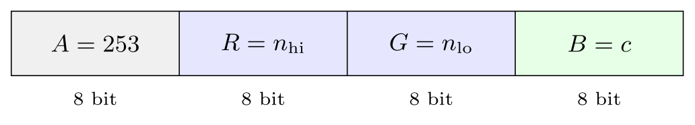
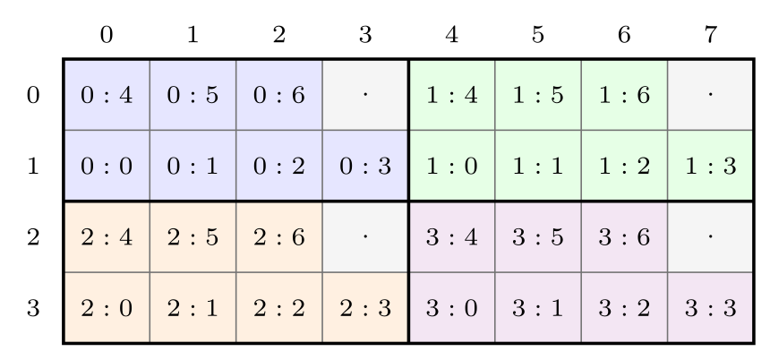
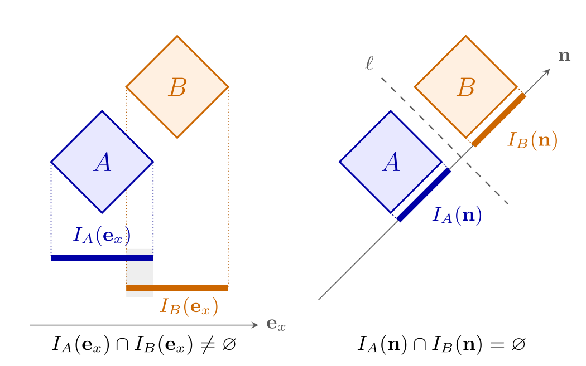
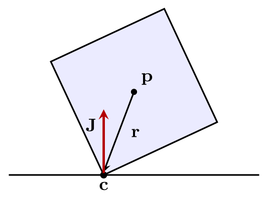

<FeatureHead
  title="Minecraft 中的像素通信与刚体模拟"
  authorName="CAIMEOX"
  resourceLink="https://github.com/CAIMEOX/mc-shader/releases/tag/datapack3"
/>

### 摘要 
本文以 Minecraft 中的三枚骰子为例，介绍如何通过粒子颜色与屏幕像素，将投掷参数传给后处理 Shader，再用持久纹理保存状态，在 GPU 上完成刚体模拟与轨迹播放。服务器预先决定点数，客户端利用立方体的对称性，让每次生成的轨迹最终呈现指定结果。

## 引言
Minecraft 26.3 的 `/posteffect` 允许数据包为玩家启用资源包中的后处理，可用于添加一些有趣的着色器效果。假如我们只想在某个事件发生时给画面加一层颜色，数据包决定何时开启效果，资源包预先写好颜色和强度。这时，一个效果名称就够用了。

如果颜色强度由动态参数决定（例如说来自 score），情况便不同了。命令仍然只能选择效果名称。我们可以预备几档强度，再按分数选择；当强度和其他状态一起变化，需要准备的效果定义就会按组合数增长。

本文我们考虑一个综合问题：设计一组由数据包触发的骰子，并且具有物理滚动效果，仅考虑近似平面的结构。服务器先保存点数，客户端负责显示投掷过程。三枚六面骰已有 $6^3=216$ 种点数组合，相同点数连续投掷时，动画还得重新开始。

## 静态穷举

在建立运行时的数据通道之前，我们先采用静态穷举。资源包为每组点数准备一个后处理定义，数据包再根据计分板中的结果拼出资源 ID。例如 `dice:roll/0_4_2_6` 对应点数 $(4,2,6)$。这些定义调用同一套 Shader，区别主要在写入 `Results` uniform 的三个值。

生成器的核心可以写成下面的 Haskell 伪代码。`effectId` 根据轮次和点数生成资源名，`effectJson` 则构造带有对应 `Results` 参数的后处理定义。

```haskell
faces :: [Int]
faces = [1 .. 6]

outcomes :: [(Int, Int, Int)]
outcomes = [(a, b, c) | a <- faces, b <- faces, c <- faces]

effects =
  [ (effectId slot result, effectJson result)
  | slot <- [0, 1]
  , result <- outcomes
  ]
```

三个独立的列表生成器枚举 $\{1,\ldots,6\}^3$，得到 $6^3=216$ 种点数组合。外层再枚举两个 `slot`，于是生成 $2\cdot6^3=432$ 份 JSON。数据包用宏函数把 `slot` 与三枚骰子的分数拼成效果 ID，再执行 `/posteffect add`。

两个 `slot` 处理连续投掷。相同的三个点数可能接连出现，但对一个已经启用的效果再次执行 `/posteffect add`，不会产生一轮新的动画。旧实现交替使用 $0$ 和 $1$ 两个效果 ID，让相邻投掷拥有不同的持久状态纹理；`slot` 本身不改变点数。

需要指出，这里的 432 是后处理定义的数量，并不一定代表 432 条不同的物理轨迹，同一个点数可以对应多条随机轨迹，也可以是所有点数共享一种轨迹，只在最后停在不同的点数上，我们后文会讨论如何设定这部分。

## 像素总线

穷举法需将每一个参数写进资源定义，三枚骰子的点数只有 216 种组合，但如果我们还想让同样的点数滚出不同的轨迹，就得再引入一个种子，资源数量也会随之增加。我们想知道，能否在投掷时把这些数值传给 Shader，让一份后处理定义处理不同的投掷？

注意到，`particle` 命令可以修改一些参与渲染的数据，例如粒子的颜色。假如 Shader 能读到这些颜色，就可以把其中的数值取出来。

### 用颜色传递参数

`minecraft:entity_effect` 是药水和状态效果使用的一种彩色粒子。它由客户端粒子系统管理，命令可以在生成时指定 `color`。这个参数接受 RGBA 浮点列表，也接受打包后的 ARGB 整数，每个通道占一个字节。例如下面的命令会在执行位置上方生成一枚红色粒子：

```mcfunction
particle minecraft:entity_effect{color:[1.0,0.0,0.0,1.0]} ~ ~1 ~ 0 0 0 0 1
```

客户端收到粒子后，会把颜色写入它的顶点属性。粒子 Core Shader 的 `Color` 输入正好能读到四个归一化的分量，乘以 255 再取整，就能恢复四个字节。这样，数据包中的一个整数便进入了 Shader。

再回到我们的问题上，先考虑我们需要传什么。三个点数 $r_1,r_2,r_3\in\{1,\ldots,6\}$ 可以按六进制编码：

$$
c=(r_1-1)+6(r_2-1)+36(r_3-1).
$$

$c$ 的范围是 $0\ldots215$，一个字节就能装下。不过，相同的点数可能连续出现，如果只传 $c$，Shader 就无法区分重复发送和再次投掷。因此我们再给每一轮一个编号 $n$，每次投掷递增，使用 16 位，超过 65535 后回到 0。模拟的随机种子也取这个编号，于是相同点数的两次投掷可以有不同的初始运动。

这两项数据合起来占三个字节，放进粒子的 RGB。剩下的 alpha 取 253，约定为通信粒子的标记。下面按 ARGB 整数从高位到低位画出四个字节：



例如点数 $(4,2,6)$ 编码为 189。如果本轮编号是 42，那么四个字节就是 `FD 00 2A BD`，按有符号的 32 位整数解释为 $-50320707$。一般地，命令使用的颜色整数为 $256n+c-50331648$，其中的「魔法」常数来自最高字节 `FD` 的有符号表示。

数据包用计分板的乘加运算算出 $c$。假设结果已保存在 `#code dice.work` 中，而 `#256 dice.const` 已初始化为 256，后面的拼装只需要：

```mcfunction
scoreboard players operation @s dice.color = @s dice.sequence
scoreboard players operation @s dice.color *= #256 dice.const
scoreboard players operation @s dice.color += #code dice.work
scoreboard players remove @s dice.color 50331648
```

然后把整数存进 storage，交给宏函数 (在新版中其实也可以用 number provider 简化这里的计算)。这里的执行者是接收效果的玩家，我们在其眼睛朝向的前方四格调用发送函数，让粒子进入玩家的渲染范围：

```mcfunction
execute store result storage dice:tx color int 1 run scoreboard players get @s dice.color
execute anchored eyes positioned ^ ^ ^4 run function dice:wire/emit with storage dice:tx
```

`dice:wire/emit` 中只有一条宏命令，数量为 1，接收者为 `@s`，它主要是接收 storage 中的颜色：

```mcfunction
$particle minecraft:entity_effect{color:$(color)} ~ ~ ~ 0 0 0 0 1 force @s
```

我们来到 Shader 这边，考虑一个解码函数，它会将颜色在投掷开始时算好，后续发送可以直接复用。顶点 Shader 读出颜色，检查标记，再把 RGB 拼回一个 24 位整数：

```glsl
ivec4 color = ivec4(round(Color * 255.0));
bool carrier = color.a == 253 && color.b < 216;
uint control = (uint(color.r) << 16u)
             | (uint(color.g) << 8u)
             | uint(color.b);
```

到这里，一枚粒子已经带来了本轮的编号和点数。后处理仍然需要一个地方读取这些信息，我们可以让粒子把数据写进画面中的几个像素，再由后处理取出。

### 相机信息

在决定这些像素的布局之前，还要考虑骰子如何跟随玩家的视角。把三维骰子投到屏幕上，需要知道当前相机朝向和透视投影。粒子 Core Shader 已经有引擎提供的 `ModelViewMat` 和 `ProjMat`，我们可以在每个渲染帧读取它们，把所需的信息和控制数据一起交给后处理。

两份矩阵一共有 32 个浮点数，不过其中有许多约束可以利用。相机旋转可以用单位四元数表示，四个分量的平方和为 1。我们选出绝对值最大的分量，通过同时改变四个分量的符号，让它非负；传递其余三个分量，就可以通过单位长度条件恢复被省略的一项。三个分量各用 15 位量化，再用 2 位记录省略的位置，共占 47 位。另一个比特用于标记这份数据存在，刚好组成六个字节。

投影矩阵则保留垂直缩放和深度系数两个参数，各用 24 位浮点编码。这里保留了单精度浮点数的符号位和指数位，并将尾数舍入到较低精度。水平缩放可以从窗口宽高比推出，近平面使用当前版本的 0.05。相机位置可以直接从全局参数 `CameraBlockPos` 和 `CameraOffset` 取得。当前重建采用第一人称、**关闭视角摇晃**时的普通透视模型。

于是粒子将要写出的消息共有 15 字节，按五个 24 位字组织：

| 字 | 内容 | 位数 |
| --- | --- | --- |
| `words[0]` | 投掷编号与点数组合 | 24 |
| `words[1..2]` | 旋转四元数的压缩表示与存在标记 | 48 |
| `words[3]` | 投影的垂直缩放 | 24 |
| `words[4]` | 去除固定偏置后的投影深度系数 | 24 |

其中三个字节来自数据包指令发送，另外十二个字节由粒子 Shader 在渲染时补入。因此，相机参数会随渲染帧更新，也不需要数据包去计算玩家的视图矩阵。

### 把消息写到角落

如果可以向一张 RGBA8 纹理逐位写入数据，每个像素能保存 32 位，那么 120 位消息只需要四个像素。但我们现在借用的是粒子的渲染路径，颜色还要经过原版透明合成。输出的 alpha 取 1，用来控制覆盖。在开启顺序无关透明合成（OIT）的测试中，RGB 出现过低位扰动，所以这里给每个颜色通道留出一些余量。

具体地说，一个通道只保存 6 位，将数值 $v\in\{0,\ldots,63\}$ 映射到八位色阶 $4v+2$，得到 $2,6,10,\ldots,254$。例如数值 32 写成色阶 130，读到 129 或 131 时仍能舍入回 32。这样每个 RGB 像素保存 $3\cdot6=18$ 位，七个像素一共提供 126 位，其中 120 位放消息，末尾六位写入固定值 45，作为数据矩形的识别标记。

编码时先连接五个 24 位字，再接上六位标记，按 18 位切成七段。下面的 `value` 表示其中一段，计算出的 `payload` 随后交给透明合成的输出分支：

```glsl
vec3 digits = vec3(
    (value >> 12u) & 63u,
    (value >> 6u) & 63u,
    value & 63u
);
vec4 payload = vec4(digits * 4.0 + 2.0, 255.0) / 255.0;
```

接下来要让七个像素落在确定的位置。粒子由四个顶点组成，顶点 Shader 可以直接改写 `gl_Position`，把它画成一个 $4\times2$ 像素的矩形。先看左上角的第一块矩形，像素坐标以左下角为原点，`ScreenSize` 是当前渲染目标的尺寸：

```glsl
const vec2 corners[4] = vec2[](
    vec2(0, 1), vec2(0, 0), vec2(1, 0), vec2(1, 1)
);
vec2 origin = vec2(0.0, ScreenSize.y - 2.0);
vec2 pixel = origin + corners[gl_VertexIndex % 4] * vec2(4, 2);

gl_Position = vec4(pixel * 2.0 / ScreenSize - 1.0, 1.0, 1.0);
```

这段计算可将像素坐标换算为裁剪空间坐标，并将 $w$ 固定为 1。只要粒子进入绘制，矩形就落在指定的像素边界上；窗口尺寸变化时，换算所用的 `ScreenSize` 也随之变化。片元 Shader 再根据 `gl_FragCoord` 算出格子编号，写入对应的 18 位数据。编号从矩形左下角开始，第一行是 $0,1,2,3$，上面一行是 $4,5,6,7$，第 7 格通过 `discard` 留空。

因此，命令中的粒子出生位置负责让它进入渲染，而 Core Shader 决定数据最终出现在画面的哪里。一枚粒子也可以画出多个不同颜色的像素，因为片元 Shader 会为每个格子分别计算输出。

### 读回消息

接收端使用 `texelFetch` 按整数坐标读取像素，避免纹理插值把相邻格子的颜色混在一起。将颜色乘以 255，再做编码的逆运算，就得到三个六位数值：

```glsl
vec3 rgb = texelFetch(source, p, 0).rgb * 255.0;
uvec3 digits = uvec3(clamp(round((rgb - 2.0) / 4.0), 0.0, 63.0));
uint value = (digits.r << 12u) | (digits.g << 6u) | digits.b;
```

像素边界每 18 位出现一次，而原来的字边界每 24 位出现一次，所以一个字通常跨越两个像素。第一个字取像素 0 的全部 18 位，再取像素 1 的高六位；第二个字接着取像素 1 的低十二位和像素 2 的高十二位。实现中用下面的移位计算恢复任意一个字，`readWirePixel` 返回上面解出的 18 位整数：

```glsl
uint readWireWord(sampler2D source, int slot, int word) {
    int start = word * 24;
    int pixel = start / 18;
    int offset = start % 18;
    uint first = readWirePixel(source, slot, pixel);
    uint second = readWirePixel(source, slot, pixel + 1);
    return ((first << uint(6 + offset))
          | (second >> uint(12 - offset))) & 0xffffffu;
}
```

这里的 `slot` 选择消息所在的矩形，我们稍后说明为何需要多个位置。五个字恢复后，接收器会检查末尾标记、四元数的存在位、点数编号和投影参数的范围，以及编号是否与槽位对应。结果编号小于 216 时，可以用六进制的逆运算还原点数：

```glsl
uint sequence = words[0] >> 8u;
uint code = words[0] & 255u;
ivec3 results = ivec3(
    int(code % 6u) + 1,
    int((code / 6u) % 6u) + 1,
    int(code / 36u) + 1
);
```

这段接收逻辑放在 `minecraft:end_of_frame` 中。它每帧把选中的五个字写入一张 $5\times1$ 的临时纹理；如果没有有效消息，就写入零。粒子的七个像素包含一条完整消息，接收端按当帧数据解码。

后面的 `dice:roll` 属于另一条后处理链，所以我们再借用主画面的 alpha 通道转交数据。15 个字节分别写入左上角 $5\times3$ 个像素的 alpha，`dice:roll` 从同一组位置读回。此时已经离开粒子透明合成，每个 alpha 通道可以使用完整的八位。收到相同编号时继续当前动画，收到较新的编号时初始化一轮模拟。

通信粒子已经覆盖了一小块场景颜色，我们用通信区下方同一列的颜色补回这些 RGB。原来的像素并没有被保存，因此在明显的颜色边界附近，这种复制仍可能留下细小痕迹。alpha 中的数据也需要后续的后处理保留。

### 重发与粒子寿命

投掷开始时，数据包立即发送一枚粒子，随后在效果启用期间每 tick 发送一枚，包括骰子收纳完成之后。正常 20 TPS 下，每秒会产生约二十枚新粒子。它们携带同一轮的控制数据，相机参数则在各自参与绘制时从当前帧取得。`dice:stop` 移除后处理效果，并停止后续发送。

这里出现了一个问题：再次投掷会更换编号，但已经发出的粒子仍然存在。骰子动画保存在 GPU 状态纹理中，新编号可以使它重新开始；通信粒子的寿命却由原版客户端管理。当前 26.3 RC2 的 `entity_effect` 会随机存活约 8～40 tick，正常速度下约为 0.4～2 秒，命令参数中没有寿命选项。因此即使上一轮骰子早已摆好，触发前一刻也可能刚发出一枚旧编号的粒子。

如果新旧粒子都向同一组像素写入数据，颜色可能在接收端读取之前就发生覆盖或混合。我们给相邻轮次分配不同的矩形，取 $s=n\bmod4$ 作为槽号，将四个 $4\times2$ 的槽位排成两行两列。下面每一格表示一个像素，$s:i$ 表示槽位 $s$ 的第 $i$ 段 18 位数据，圆点表示粒子留空的位置；横纵标号均从画面左上角开始：



接收器分别解码四个矩形，再按 16 位编号的回绕规则选择较新的消息。若 $d=(n_{\mathrm{new}}-n_{\mathrm{old}})\bmod65536$ 满足 $0<d<32768$，就把前者视为较新的一轮。一个粒子写七个 RGB 像素，四个槽位最多对应 28 个 RGB 位置；alpha 中转的 $5\times3$ 区域与它们重叠，合计最多涉及 30 个像素位置，全部位于左上角 $8\times4$ 的范围内。

当然，这也不是完美方案，四个槽位只能分开相邻的几轮。如果编号 100 的粒子还没消失，投掷已经进行到 104，它们仍会写进同一块矩形。因此这套布局不能保证快速连续触发时的可靠性。接收端的字段检查可以排除一部分错误颜色，但选择最新编号的前提是先读出消息，无法消除发生在解码之前的混色。

一个可行的解决方案是缩短粒子参与通信的时间。例如我们每 tick 都发送新粒子，就可以考虑让每枚粒子只写入两 tick。Shader 可以丢弃片元，使仍在客户端存活的粒子停止写入，不过粒子接口没有直接提供年龄参数，借助随年龄变化的贴图帧来判断还需要验证，在撰写本文时，我还没来得及测试。

## 在着色器里模拟刚体

现在，后处理已经知道本轮的点数和编号，也能取得相机信息。接下来要考虑骰子怎样运动。最初的 demo 使用了 MuJoCo 来做预制动画：预先烘培好下落、弹跳和旋转的过程，播放时根据经过的时间取出位置与朝向，再让骰子停在指定的结果面上。这种做法可以先把投掷到收纳的过程接起来，也容易控制整段动画的时长，并且它确实非常省算力，我们只需要从一个预制轨迹 (我之前通过图片把它存放在资源包中) 里读数据。

不过，当我们希望每次的动画都不同，事情就复杂了。于是我有了一个更疯狂的想法：直接在 Shader 里写一个物理模拟系统。GLSL 已经能够做向量运算、循环和条件判断 (这条件可比使用 mcfunction 好太多了！)，而上一节又说明了纹理可以保存数值。如果每一遍着色器都从纹理里读出当前状态，算出一个很短的时间步之后的状态，再写回纹理，就可以把运动一步一步推进下去。

### 保存状态

先把骰子看成均质的刚体。它在运动中保持形状，我们只需要记录中心位置 $\mathbf p$、朝向 $q$、线速度 $\mathbf v$ 和角速度 $\boldsymbol\omega$。朝向仍用单位四元数表示，因此一枚骰子需要 $3+4+3+3=13$ 个浮点数：

```glsl
struct RigidBody {
    vec3 p;
    vec4 q;
    vec3 v;
    vec3 w;
};
```

三枚骰子一共占 39 个数，再加上步数、阶段、种子等 12 个全局字段，以及一个投掷编号，物理状态共有 52 个字段。我们把它们放进一张 `52×1` 的 RGBA8 纹理，每个像素保存一个 32 位数值的位模式。写入浮点数时，用 `floatBitsToUint` 取得位模式，拆成四个字节，读回后用 `uintBitsToFloat` 恢复。这张内部纹理直接在后处理之间传递，可以使用完整的四个颜色通道。

更新时准备 A、B 两张状态纹理，一遍读取 A、写入 B，下一遍再读取 B、写入 A。每次计算都以前一份完整状态为输入，`persistent` 则让最后一份结果保留到下一帧。新的投掷编号到达后，我们重新生成初始状态，包括三枚骰子的姿态、线速度和角速度。

这里的求解放在顶点着色器中，三个刚体在同一次调用里联合更新。绘制用的全屏三角形有三个顶点，它们各自计算出相同的结果，再通过 `flat` 输出交给片元着色器。片元阶段按照像素下标，把对应字段写入状态纹理。这样，推进一次模拟所需的计算量由刚体和接触数量决定。

### 先让骰子落下

暂时只考虑重力。给定一个很短的时间步 $h$，先用加速度更新速度，再用新的速度更新位置，这就是半隐式 Euler 积分：

$$
\begin{aligned}
\mathbf v_{k+1}&=\mathbf v_k+h\mathbf g,\\
\mathbf p_{k+1}&=\mathbf p_k+h\mathbf v_{k+1}.
\end{aligned}
$$

旋转也按这个时间步推进。角速度的方向给出旋转轴，模长乘以 $h$ 给出转角，据此构造一个增量四元数，与当前朝向相乘并归一化。忽略碰撞和阻尼时，更新的主体只有几行：

```glsl
body.v += vec3(0.0, -9.81, 0.0) * dt;
body.p += body.v * dt;
body.q = integrateRotation(body.q, body.w, dt);
```

我们取基准步长 $h=1/240$ 秒。这里的 240 是模拟时间的划分方式，绘制一帧可以连续执行多个步长。每一步还会根据平移距离和旋转扫过的距离继续细分，最多分为八个子步，使运动较快的骰子也有更多机会检测到接触。有限的细分仍有适用范围，任意高速运动需要更完整的连续碰撞检测。

### 找出接触点

自由落体会让骰子一直掉下去，我们还需要知道它什么时候碰到地面。在模拟坐标系中，地面设为 $y=0$。将立方体的八个顶点按当前姿态变换后，检查它们的高度，就能找到靠近或穿入地面的顶点。这些点会成为后面求解的接触点。

两枚骰子之间要稍微复杂一些。旋转后的骰子是有向包围盒（OBB），我们使用分离轴定理：把两个盒子投影到某个方向，如果投影区间之间还有间隔，它们就没有相交。我们考虑下面这个简单例子，左右两图是同一对物体，只改变投影方向。蓝色和橙色线段分别表示它们在该方向上的投影区间。



左图将两段水平投影上下错开显示，灰色区域标出它们在横轴上的重叠范围。仅凭这个方向，还无法判断物体是否相交。右图改为沿矩形一组边的法线 $\mathbf n$ 投影，两个区间之间出现了空隙，因此找到了一个分离轴。与 $\mathbf n$ 垂直的虚线 $\ell$ 可以穿过这道空隙，将两个矩形放在两侧。只要找到这样一个方向，就能确定它们没有相交。

三维盒子需要检查十五个候选方向，包括两个盒子各自的三条局部轴，以及两组轴两两叉乘得到的九个方向；近乎平行的叉乘轴会被跳过。实现还加入了一点接触余量，在物体即将接触时建立约束。

检测到接触后，还得知道接触发生在哪里。面与面接触时，求解器选择参考面，用它的侧边界裁剪另一个面，得到一组接触点；棱与棱接触时，则计算两条线段上的最近点。一个平放的骰子可以同时拥有多个地面接触点，这些点共同限制它继续下落和倾倒。

每个接触记录两枚刚体的编号、接触位置、法线和穿透深度。地面作为静止的另一方处理。当前物理环境只有三枚等质量、边长为 0.44 格的立方体和一个水平面；这个平面对应启动时从场景深度选定的落点。场景里的台阶和墙壁仍可参与画面遮挡，但它们尚未成为求解器的碰撞输入。

### 碰撞怎样变成滚动

接触点并不一定和骰子中心拥有相同的速度。设接触点相对中心的位置为 $\mathbf r$，它的速度是 $\mathbf v+\boldsymbol\omega\times\mathbf r$。比较接触双方在这个点的速度，就能判断它们正在靠近、分离，还是沿表面滑动。

我们通过冲量改变这些速度。一个作用于接触点的冲量 $\mathbf J$，会同时改变刚体的线速度和角速度：

$$
\begin{aligned}
\Delta\mathbf v&=\frac{\mathbf J}{m},\\
\Delta\boldsymbol\omega&=I^{-1}(\mathbf r\times\mathbf J).
\end{aligned}
$$

这里 $m$ 是质量，$I$ 是转动惯量张量。冲量的作用线经过中心时，$\mathbf r\times\mathbf J=0$；偏离中心时，它就会改变骰子的旋转。下面画的是一个截面，骰子的一角碰到地面，向上的接触冲量通过力臂 $\mathbf r$ 产生转动：



三枚骰子的质量都取 1，均质立方体的惯量在各个方向上相同，所以逆惯量可以存成一个标量。对两个骰子施加大小相等、方向相反的冲量时，代码可以写成：

```glsl
bodies[a].v += J;
bodies[a].w += INVERSE_INERTIA * cross(ra, J);
bodies[b].v -= J;
bodies[b].w -= INVERSE_INERTIA * cross(rb, J);
```

接下来要决定冲量有多大。我们采用顺序冲量（Sequential Impulses）的方法，依次处理接触点，根据当前相对速度修正冲量，再重复多轮，让一个接触点带来的变化传播到其他接触点。法向累计冲量保持非负，表示接触只能把物体推开；切向冲量用于抵消滑动，其大小限制在库仑摩擦范围 $\lVert\mathbf J_t\rVert\le\mu J_n$ 内。这里摩擦系数取 0.6，碰撞恢复系数取 0.38，接近静止的接触不再主动产生回弹。

当前每个子步执行二十轮速度约束求解。接触点先在预估位姿上生成，得到修正后的速度后，再从步长开始时的位姿重新积分。这样，摩擦也会影响本步的实际位移。随后用八轮独立的位置修正处理剩余穿透，修正量只用于调整位置和朝向，不写入动力学速度。

因此，一次偏心碰撞可能同时产生弹跳、侧移和翻转。初始位置与速度改变后，接触顺序也会改变，整段运动便由这些接触逐步算出来。

### 模拟时间与播放时间

还有一件事需要决定：什么时候把模拟显示出来？我们选择先在 GPU 上算完一轮，再播放记录下来的轨迹。每个渲染帧安排八个基准步，并把每一步的状态写入历史纹理。单轮最多 1440 步，对应六秒模拟时间，连同初始状态一共预留 1441 列。帧率主要影响这段准备过程需要等待多久，求解器本身仍按固定步长推进。

当三枚骰子的速度和穿透都足够小，连续维持六十步，并且每枚骰子都有一个面接近水平时，就认为本轮已经停稳。若出现非有限数值，或者耗尽步数仍未停稳，则记录失败状态，不开始播放。这些判断使准备过程有一个明确的结束条件。

播放时，将本轮实际得到的轨迹重新映射到四秒。位置在相邻记录之间线性插值，朝向使用四元数球面插值（SLERP）。因此每一轮轨迹都是由当前种子重新求解的，同时仍可以控制玩家看到的演出时长。启动时选定的平面也在这段过程中保持不变。

### 让预定的点数朝上

服务器在投掷开始前已经确定了点数，而物理模拟会自然停在某个朝向。这两件事如何同时成立？答案是先算完再播放，正好让我们能够在显示第一帧之前知道最后哪个面朝上。

考虑一个没有点数图案的均质立方体，将它绕局部坐标轴旋转九十度，几何外形仍与原来重合。这类旋转是立方体的对称变换。我们从中选择一个固定旋转 $S$，让指定点数所在的局部面对应模拟最终朝上的面。若模拟得到的旋转矩阵为 $R(t)$，就将整段轨迹的朝向统一改为：

$$
R'(t)=R(t)S.
$$

这里右乘的 $S$ 在整轮投掷中保持不变。因为 $S$ 将立方体映回自身，所以每个时刻的碰撞外形都保持相同；均质立方体的惯量也不受影响。点数从播放开始就固定在各自的面上，整段翻滚连续地到达服务器指定的结果。轨迹播放结束后，再进入停留和收纳阶段，通过平移与旋转把结果面转向玩家。

## 结语

回到最初的问题，我们现在可以让同一份后处理定义接收本轮的点数，并为每次投掷重新生成运动。粒子的颜色提供输入，持久纹理保存前一步的状态，Shader 再从这些状态算出下一步。把它们接起来之后，原本需要逐一安排的弹跳和翻滚，就可以交给求解器处理。

这套效果仍由服务器决定点数和游戏规则，客户端负责生成与展示轨迹。GPU 何时完成求解，并不会沿这条通道回传给服务器。当前实现也有它的边界：碰撞环境是固定水平面 (着色器获取的客户端信息有限，我想一个可行的解决方案是把地形信息一起编码传递，但这非常繁琐)，快速重投时的粒子覆盖问题还需要继续处理。使用这些效果时，游戏逻辑和画面表现需要分别考虑。本 demo 构建的数据包可以前往 [github release](https://github.com/CAIMEOX/mc-shader/releases/tag/datapack3) 下载，视频见 [Bilibili](https://www.bilibili.com/video/BV1xVho6UEBw)。更进一步，我们可以利用这个技术构建流体模拟、火焰模拟甚至 LLM 等更令人惊叹的作品，这些样例均可在 github 页面寻得。