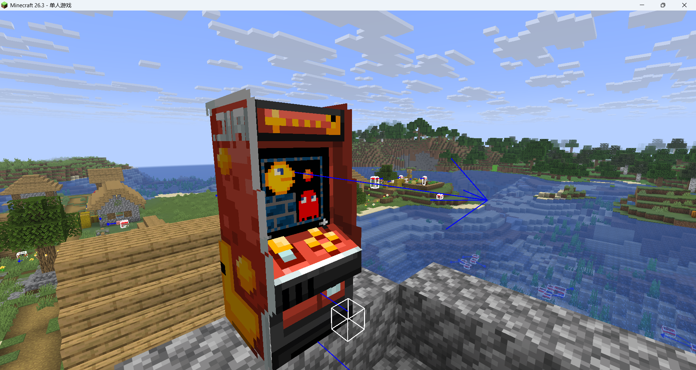

<FeatureHead
  title="用数据包造一台街机：多实例架构"
  authorName="洪旗"
/>


## 1. 引言

这个项目是从"想在 Minecraft 里做一个吃豆人"开始的。最初的想法是用对话框：它天然只对单个玩家显示，内容又由文本组件拼装，而文本组件能承载自定义字体的字符——社区里已经有人这么画过盘面、做过接水管和推箱子之类的小游戏，看起来顺理成章。动手后发现有两个问题无法用这种方式解决
。**一是画布**：对话框的可视区域属于游戏 UI，吃豆人需要 $28 \times 31$ 的盘面需要排下来近九百个字符，纵向 31 行还会被高度与换行逻辑切割，没法在一屏里完整呈现。
**二是输入**：对话框里能用的交互只有"点击选项"，而吃豆人要求玩家高频、连续地改变方向，鼠标完全不胜任。
权衡之后改成"用展示实体当屏幕、用座位读按键"的方案。这个改动原本只是为了绕开限制，中途却发现它意外的很好用，还带来了一些对话框在原理上给不了的东西：首先是同一块屏对所有玩家可见，同时解放了原版的整套按键，利用一些技巧还能进一步检测长按、边沿甚至组合按键。于是它从一次妥协变成了方案的基础，进一步催生出了这一项目。
代价也随之出现：屏幕成了世界里真实存在的实体，多台机器同时开机、互不串档就成了必须自己解决的问题——第 3、4 节讲的就是这两件事。

本项目（下称"街机包"）用数据包与资源包实现了这台机器：外壳命名空间 `arcade_machine` 负责"机器"本身，内部挂载 `pac_man`、`2048`、`sneak`(英语水平差劲，原本是 `snake`的)、`russia`、`russia_pk` 五个游戏命名空间。

本文只讲"街机"这一层：一台机器需要什么组成（第 3 节）、多台街机如何隔离（第 4 节）、如何给出画面（第 5 节）、如何控制计算预算（第 6 节）、一段游戏逻辑怎么跑（第 7 节），以及这套结构的通用性与几招技巧（第 8、9 节）。

## 2. 总体结构

目前的街机包是一个外壳加上五个游戏：外壳与五个游戏各自拥有独立的命名空间，各自在 `minecraft:tick` 上挂一个入口，同一个游戏刻里按固定顺序执行。
**表 1：命名空间划分**

| 命名空间 | 职责 |
| --- | --- |
| `arcade_machine` | 机器实体、落座/离座、选游戏、分机 |
| `pac_man` | 吃豆人 |
| `sneak` | 贪吃蛇 |
| `2048` | 2048 |
| `russia` | 俄罗斯方块 |
| `russia_pk` | 俄罗斯方块双人对战大厅 |

每个命名空间内部采用同一套三段式存储，这条约定让五个游戏可以互不干扰地并行。
**表 2：三段式存储**

| 存储 | 内容 | 读写性质 |
| --- | --- | --- |
| `<ns>:base` | 静态预设：关卡网格、字形表、实体初始状态 | 只读，只在 `load` 时写入 |
| `<ns>:game` | 处理区：逻辑地图、渲染缓冲、分数、各实体坐标 | 每帧读写 |
| `<ns>:mid` | 宏参数载体与临时变量 | 用后即弃 |

## 3. 机器组成

原版没有"可放置的机器"这种对象，但可以把它的三个职责分给三种实体。
**表 3：一台机器的实体构成**

| 实体 | 职责 | 关键字段 |
| --- | --- | --- |
| `item_display` | 机箱与外壳造型 | `item.item_model` + `custom_model_data.floats[0]`：`0` 为关机，`1..5` 对应五款游戏的贴图 |
| `interaction`（1×2） | 拆机交互区 | 被左键攻击时触发拆机；右键落座后把 `width` 改为 0 避免重复触发 |
| `interaction`（0×0） | 座位兼存档载体 | 挂 `data.game`、`data.score`、`data.key`，玩家 `ride ... mount` 到它身上；座位高度取 0 即可让乘客贴合地面 [3] |

第三种实体是整个项目的枢纽：它既是"能被骑乘的物理位置"，又因为实体 NBT 天然持久化，直接成了这台机器的存档格。

**投放与配对。** 道具落地后生成一个带标记的临时实体，`tick` 检测到它就进入召唤流程：在机位召唤展示实体当屏幕，再召唤交互框与座位。


- 为了方便查看，这里将作为座椅的交互实体边长调整为0.2而不是0

**落座与拆机：用进度当事件源。** 玩家进入机器不靠每刻轮询，而是借两个**进度**：右键交互实体触发 `player_interacted_with_entity`，左键攻击触发 `player_hurt_entity`。进度只做匹配、不做逻辑，把处理交给奖励函数：

```json
"rewards": { "function": "arcade_machine:normal_int/sit_mid" }
```

落座时把玩家转向机器、`ride` 上去、把外观切到"开机"，并**把 1×2 交互实体的 `width` 改成 0**——否则玩家在游玩中会不断误触街机的交互框——离座时再改回 1。拆机则给非创造模式玩家掉落一台机器的道具，然后把同组实体全部清除。



- 坐上之后，交互实体体积箱消失

## 4. 多实例隔离

### 4.1 状态存在座位上

街机包将把每台机器的状态存在它的座位实体里。每个游戏每一刻开头与结尾各做一次对拷：

```mcfunction
data modify storage russia:game game  set from entity @s data.game
data modify storage russia:game score set from entity @s data.score
......

##本刻的全部逻辑

......
data modify entity @s data.game  set from storage russia:game game
data modify entity @s data.score set from storage russia:game score
```

这样多台机器成功达成隔离（各读写各自的实体），不会互相之间串数据。

### 4.2 组号与三级标签

由于显示和数据不在同一个实体上，一些操作需要筛选目标实体。街机包将一个记分板分数作为组号（`arcade_machine_pair`），机器的三个实体打上同一个号，再加上相应的标签来区分。
**表 4：三级过滤**

| 标签 | 语义 | 生命周期 |
| --- | --- | --- |
| `<game>_all`、`arcade_all` | 该游戏 / 全街机的实体全集 | 召唤时打上，拆除时清除 |
| `<game>_pair` | **本机**实体 | 函数进入时打、退出时清 |
| `arcade_machine_pair` 分数 | 持久组号 | 与机器同寿命 |

组号用**递归找空号**分配：取当前号，若已被任何 `arcade_all` 实体占用就 +1 再试，直到找到没人用的数字。

```mcfunction
execute as @e[tag=arcade_all] if score @s arcade_machine_pair = #pair arcade_machine_pair \
  run scoreboard players set #test arcade_machine_pair 1
execute if score #test arcade_machine_pair matches 1 run return run function arcade_machine:pair/start
```

有了组号，所有"同机实体"的选择都变成标签相符与分数相等两个条件，就能很轻易地找出目标实体

## 5. 如何给出画面

屏幕换成展示实体之后，画面要解决的只剩"怎么把一块二维数组变成一串文本组件"。

### 5.1 双地图：逻辑层与显示层

以吃豆人为例，它同时维护两张**尺寸相同、值域不同**的地图。
**表 5：两层地图的分工**

| | `map`（逻辑层） | `map_all`（显示层） |
| --- | --- | --- |
| 内容 | 墙 + 豆 + 奖励物品 | 墙 + 豆 + 奖励物品 **+ 玩家 + 幽灵** |
| 值域 | `0..12` | `0..32` |
| 谁在读 | 计分、吃豆、放奖励物品 | 碰撞判定、渲染 |
| 写入方式 | 吃到时置 0 | **每帧从 `map` 重建并修改，即时失效** |

分层的主要目的是分离渲染与逻辑，举个例子，如果不进行分离，那么当幽灵移动占据豆子所在的格时，我们就失去了**这个格子里是豆**这一信息，从而导致视觉上幽灵也会吃掉豆子的结果。而分离之后，我们可以将幽灵的位置单独储存，渲染时再替换对应的位置，这样格子里原本的内容得以保留。


- 利用展示实体搭出画面

## 6. 控制计算预算

"一帧"在游戏里通常意味着五件事：读输入、跑逻辑、判碰撞、叠图层、出画面。全塞进一个 tick，容易出现指令过多导致的卡顿甚至卡死，因此必须缓解计算压力。

### 6.1 给帧编号：以吃豆人为例

最直接的做法是给帧配一个每刻递减的计数器，本项目的 `#pace`。
**表 6：吃豆人的帧调度**

| `#pace` | 本刻执行 |
| --- | --- |
| 2 | 红鬼、橙鬼寻路 |
| 1 | 蓝鬼、粉鬼寻路 |
| 0 | 玩家移动 → 碰撞/吃豆判定 → 图层叠加 → 渲染，然后复位为 3 |

这样，原本在一个 tick 执行的大量指令被分摊到三个 tick，压力大大减小。

### 6.2 熔断与降级

拍数分配只解决"平均每拍多少"，不解决"最坏情况多少"。比如贪吃蛇的ai蛇，在存在豆子时会用BFS算法找出到达豆子的路径，但是在某些局面下需要的指令过多，就可能把命令链撑爆，所以下一次决策额外加了一道熔断：

```mcfunction
scoreboard players add #bfs_steps sneak_cal 1
execute if score #bfs_steps sneak_cal matches 101.. run return run function sneak:move/bfs/wander/start
```

扩展超过 100 格就放弃寻路、退化成随机游走，避免卡死。

## 7. 一段游戏逻辑怎么跑

在本包内，所有的游戏逻辑都遵循以下顺序
**表 7：一次 tick 的四步闭环**

| # | 做什么 | 命令形态 |
| --- | --- | --- |
| 1 | 本体存档 → 处理区 | `data modify storage <ns>:game … set from entity @s data.…` |
| 2 | 读输入 | 将当前玩家按键存储到分数里备用 |
| 3 | 运算 | 在 `<ns>:game` 与计分板里改数据 |
| 4 | 处理区 → 本体存档 | `data modify entity @s data.… set from storage <ns>:game …` |

### 7.1 第一步：把本体存档拷进处理区

```mcfunction
data modify storage <game>:game game  set from entity @s data.game
data modify storage <game>:game score set from entity @s data.score
```

不直接在实体上改，主要是因为便宜：storage 的单次读写只有实体 NBT 的十几分之一（根据参考资料[4] 的实测：storage 单值约 5.5 个 `score-add` 单位，读整个实体约 160 单位），而第 3 步会反复读同一份状态，不移动到处理区，开销相当之大。

### 7.2 第二步：用 `on passengers` 和谓词读输入

函数的执行者始终是座位实体，玩家只是它的乘客。要知道"玩家按着什么键"，就用 `on passengers` 把执行者临时切到乘客，再用玩家谓词读输入：

```mcfunction
execute on passengers if predicate {type:"entity_properties",entity:"this",predicate:{"type_specific/player":{input:{left:true}}}} run scoreboard players set #left pac_man_cal 1
```

但"按着"，"刚按下"，"刚松开"是不同的情况，为了避免在不该有的连续触发，每个键还要配一个"上一刻"寄存器：

```mcfunction
execute if score #left pac_man_cal matches 1 if score #left_las pac_man_cal matches 0 run scoreboard players set #facing pac_man_cal 3
scoreboard players operation #left_las pac_man_cal = #left pac_man_cal
```

只有"这一刻是 1、上一刻是 0"才算一次新的按下。相应的，"这一刻是0、上一刻是1"是一次松开

### 7.3 第三步：在 storage 与计分板里运算

这一步没有固定形态，其内容取决于开发者需要的制作的内容，这部分是真正意义上的源代码。
比如吃豆人的这一步中包含了幽灵的寻路，幽灵与玩家的移动，碰撞判定。
俄罗斯方块则包括每次下落，左右移动，加速下落，硬降落，旋转，落地判定，消除等。
这一步最后还需要对画面进行更新。

### 7.4 第四步：写回本体，再按组分发

处理完之后，处理区里的数据写回本体存档，给下一次处理做准备，同时避免污染。

```mcfunction
data modify entity @s data.game  set from storage <game>:game game
execute as @e[tag=pac_man_for,tag=pac_man_pair,limit=1] run data modify entity @s text set from storage pac_man:game body
```

### 7.5 骨架

```mcfunction
## <game>:tick —— 对每台机器跑一次
execute as @e[tag=<game>_player] run function <game>:mid

## <game>:mid
## 1 存档 → 处理区
data modify storage <game>:game game  set from entity @s data.game
data modify storage <game>:game score set from entity @s data.score
## 2 读输入
execute on passengers if predicate {…input…} run scoreboard players set #left <game>_cal 1
## 3 运算
function <game>:control/start
## 4 处理区 → 存档
data modify entity @s data.game  set from storage <game>:game game
```

## 8. 新游戏如何接入

前面几节都是从外壳出发看问题，这一节反过来：一个新游戏要提供什么，才能挂到这台机器上。对于游戏来说，需要提供以下两项：
**表 8：新游戏需要提供的两项接口**

| 接口 | 必须做到 |
| --- | --- |
| `<game>:base` | 交出静态预设：关卡网格、字形表、实体初始状态。游戏与外壳都只读它，换关卡、换贴图只改这一块 |
| `start/init` | 由外壳在机器上下文里调用：建立本机的展示实体、把初始状态写进座位、把状态设成"暂停" |

两项的分工是"数据"与"入口"：`base` 把会变的东西集中到一块只读存储里，`init` 给出唯一的外壳调用点。其余的事——tick 怎么排、状态怎么存、实体怎么筛——都归游戏自己管，外壳不参与。

此外外壳侧还有三处硬编码要同步登记：`choose/game` 里"`custom_model_data` 的哪个值对应哪个游戏"、`choose/left|right` 的回绕上限（当前为 5），以及资源包里物品模型的 `range_dispatch` 阈值。

所以接一款新游戏的实际成本是：写一份 `base`、一个 `init`，再登记三处硬编码。反过来说，这个外壳对游戏内部的代码没有很严格的要求，只要能保证不影响其他游戏即可，自由度相当高

## 9. 几招与玩法无关的技巧

这一节收的是**与具体玩法无关**的招法。它们的主要意义在于减少需要维护的状态与分支
**表 9：与玩法无关的几招**

| 想解决的问题 | 方式 | 本项目的用法 |
| --- | --- | --- |
| 临时"允许 / 禁止"某个行为 | 读取前加 `if data …` 前置，**删掉字段即视为允许** | 删 `facing` 允许反向（散开切换、受惊、重生三处复用） |
| 用一个数表示两个阶段 | 在正负区间分别递减 / 递增，归零换相 | 散开 ↔ 追击：$160 \to -340 \to 160$ |
| 用一个数表达多个维度 | 不存表，用公式现算下标 | 连续吃鬼分数依次为200、400、800、1600，倍率本身就是计数 |

其中最值得单独说的是第一招：**删除字段即允许反向**。"不能反向"本来要么一个布尔量，要么一个"当前方向 + 是否禁止掉头"的枚举；这里改成在读字段前加一个前置条件：

```mcfunction
$execute if data storage pac_man:game game.$(type).facing if score #facing pac_man_cal matches $(facing) run return 0
```

字段不存在，命令就不成立，于是"字段缺失"就等于"允许反向"。三个需要掉头的地方都退化成一行 `data remove`。

## 10. 结语

回到引言里的那个取舍：屏幕做成展示实体，和用对话框，究竟各自适合什么。

**对话框的优势是"轻"与"私密"。** 它只对打开的玩家显示，多实例隔离是免费的——每人一份，不用组号也不用分机；尺寸与布局交给 UI 系统，点选直接对应 trigger，做菜单、表单、信息面板都很省事。推箱子、接水管、象棋这类回合制或点选操作的小游戏，用对话框反而更合适：操作是离散的点击，画面再大也不过几十个格子，没有必要为它去搭一套实体。它的短板也很清楚：画布尺寸不受控，输入只有"点击选项"。

**展示实体屏幕的优势是"大"与"自由"。** 尺寸可以由自己定——`transformation.scale` 配一个调大的 `line_width`，即使是 $28 \times 31$ 的迷宫也能一屏放下，这是对话框给不了的。自由在于操作，玩家坐在实体上，对话框中不可用的按键得到了解放，配上边沿检测还能区分"按下、按住、松开"，也能做组合键；而对话框能用的只有"点击选项"。正因输入够自由，才做得出"每秒数次变向"这类街机操作。

代价来自同一处。屏幕在世界里，就默认对所有人可见：共享屏天然不隔离，每台机器都得自己做组号与多实例，还要处理朝向、可见性和实体数量；玩家要坐上去才有输入，于是落座、离座、脚下的误触也要一并兜住。

所以选择的依据可以压成三个问题：**画面有多大、操作有多密、要不要围观**。三个答案都偏向"大、密、要"的时候——也正是街机游戏的定义——展示实体几乎是唯一的选择；反过来，菜单、解谜、回合制这些"小、疏、私"的场景，对话框更省事、也更好维护。本项目选展示实体作为方案，只因为要做的是街机，而不是因为后者不好。

## 参考文献

[1] [徐木弦, 洪旗（洪色羽毛）. 用 Minecraft 还原接水管小游戏：基于 Prim 算法的随机树生成和基于 Tarjan 算法的环路搜索[J/OL]. Feature, 2026, 6(2).](https://cr-019.github.io/datapack-index/feature/archive/202606/0/content.html)

[2] [CR_019. 拾尘（八）—— 使用对话框制作 2D 小游戏[J/OL]. Feature, 2025, 6(1).](https://cr-019.github.io/datapack-index/feature/archive/202506/5/content.html)

[3] [我吃大白菜. 全实体「乘骑座位高度」探究[J/OL]. Feature, 2026, 9(2).](https://cr-019.github.io/datapack-index/feature/archive/202609/6/content.html)

[4] [伊桑桑桑桑桑. 从宏到 NBT：Minecraft 26.3 数据包性能实测[J/OL]. Feature, 2026, 9(2).](https://cr-019.github.io/datapack-index/feature/archive/202609/0/content.html)

[5] [伊桑桑桑桑桑. 如何检测玩家按下了什么键[J/OL]. Feature, 2026, 6(2).](https://cr-019.github.io/datapack-index/feature/archive/202606/3/content.html)

[6] [洪旗. 队列在数据包中的使用[J/OL]. Feature, 2025, 11(1).](https://cr-019.github.io/datapack-index/feature/archive/202511/3/content.html)
