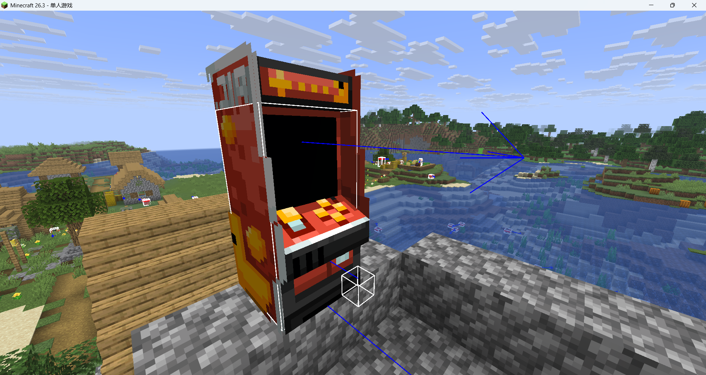
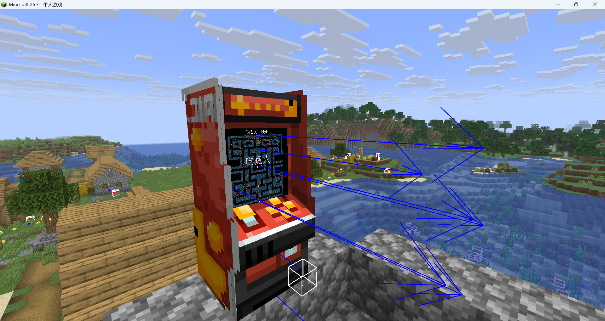

<FeatureHead
  title="用数据包造一台街机：多实例架构"
  authorName="洪旗"
/>

<script setup>
import ns from '/.vitepress/vue/nbt/namespace.vue'
import obj from '/.vitepress/vue/nbt/object.vue'
import list from '/.vitepress/vue/nbt/list.vue'
</script>

## 1. 引言

这个项目是从"想在 Minecraft 里做一个吃豆人"开始的。最初的想法是用对话框：它天然只对单个玩家显示，内容又由文本组件拼装，而文本组件能承载自定义字体的字符。\
社区里已经有人这么画过盘面、做过接水管和推箱子之类的小游戏，看起来顺理成章。动手后发现有两个问题无法用这种方式解决：
1. **画布**：对话框的可视区域属于游戏 UI，吃豆人需要 $28 \times 31$ 的盘面需要排下来近九百个字符，纵向 31 行还会被高度与换行逻辑切割，没法在一屏里完整呈现。
2. **是输入**：对话框里能用的交互只有"点击选项"，而吃豆人要求玩家高频、连续地改变方向，鼠标完全不胜任。

权衡之后改成用展示实体当屏幕、用座位读按键的方案。这个改动原本只是为了绕开限制，中途却发现它意外的很好用，还带来了一些对话框在原理上给不了的东西：首先是同一块屏对所有玩家可见，同时解放了原版的整套按键，利用一些技巧还能进一步检测长按、边沿甚至组合按键。于是它从一次妥协变成了方案的基础，进一步催生出了这一项目。\
代价也随之出现：由于屏幕成了世界里真实存在的实体，多台机器同时开机时必须互不串档。这部分问题在第 3、4 节探讨。

本项目（下称"街机包"）用数据包与资源包实现了这台机器：<ns t='arcade_machine'/>中包含机器本身的逻辑，除此之外还有`pac_man`、`2048`、`sneak`(英语水平差劲，原本是 `snake`的)、`russia`、`russia_pk`五个游戏命名空间。

本文只会探讨机器本身如何实现。

## 2. 机器组成

原版没有"可放置的机器"这种对象，但可以把它的三个职责分给三种实体。

| 实体 | 职责 |
| --- | --- |
| <ns t='item_display'/> | 游戏机箱与外壳造型  |
| <ns t='interaction'/>（1×2） | 拆机的交互按钮 |
| <ns t='interaction'/>（0×0） | 玩家的骑乘位兼存档载体 |

第三种实体是整个项目的枢纽：它是玩家骑乘的物理位置，并且直接存储了这台机器的存档。

**投放与配对。** 道具落地后生成一个带标记的临时实体，`tick` 检测到它就进入召唤流程：在机位召唤展示实体当屏幕，再召唤交互框与座位。



- 为了方便查看，这里将作为座椅的交互实体边长调整为0.2而不是0

**落座与拆机：用进度当事件源。** 玩家进入机器不靠每刻轮询，而是使用进度触发。右键交互实体触发<ns t='player_interacted_with_entity'/>，左键攻击触发<ns t='player_hurt_entity'/>。

落座时把玩家转向机器、<cmd c='ride'/>上去、把外观切到"开机"，并把拆机按钮交互实体的 `width` 改成 $0$ 以防止玩家在游玩中误触街机的交互框。拆机则给非创造模式玩家掉落一台机器的道具，然后把同组实体全部清除。


- 坐上之后，交互实体体积箱消失

## 3. 多实例隔离

### 3.1 状态存在座位上

街机包将把每台机器的状态存在它的座位实体里。每个游戏每一刻开头与结尾分别把数据读写出入storage：

```mcfunction
data modify storage russia:game game  set from entity @s data.game
data modify storage russia:game score set from entity @s data.score
......

##本刻的全部逻辑

......
data modify entity @s data.game  set from storage russia:game game
data modify entity @s data.score set from storage russia:game score
```

这样多台机器成功达成隔离（各读写各自的实体），不会互相之间串数据。

### 3.2 组号与三级标签

由于显示和数据不在同一个实体上，一些操作需要筛选目标实体。街机包将一个记分板分数作为组号，机器的三个实体的组号相同，再以标签区分。

| 标签 | 语义 | 生命周期 |
| --- | --- | --- |
| `<game>_all`、`arcade_all` | 该游戏 / 全街机的实体全集 | 召唤时加上，拆除时清除 |
| `<game>_pair` | **本机**实体 | 函数进入时加上、退出时清除 |
| `arcade_machine_pair` 分数 | 持久组号 | 与机器同寿命 |

组号用**递归找空号**分配：取当前号，若已被任何 `arcade_all` 实体占用就 +1 再试，直到找到没人用的数字：

```mcfunction
# 寻找组号
execute as @e[tag=arcade_all] if score @s arcade_machine_pair = #pair arcade_machine_pair \
  run scoreboard players set #test arcade_machine_pair 1
execute if score #test arcade_machine_pair matches 1 run return run function arcade_machine:pair/start
```

有了组号，所有"同机实体"的选择都变成标签相符与分数相等两个条件，就能很轻易地找出目标实体了。

## 4. 画面

屏幕换成展示实体之后，我们只需要解决怎么把数据变成一串文本组件的难题。

### 4.1 双地图：逻辑层与显示层

以吃豆人为例，它同时维护两张**尺寸相同、值域不同**的地图：

| | `map`（逻辑层） | `map_all`（显示层） |
| --- | --- | --- |
| 内容 | 墙 + 豆 + 奖励物品 | 墙，豆，奖励物品，玩家，幽灵 |
| 用途 | 计分、吃豆、奖励 | 碰撞判定、渲染 |

显示层会每刻从逻辑层复制并修改。下一刻会重新绘制新的显示层。

分层的主要目的是分离渲染与逻辑，举个例子，如果不进行分离，那么当幽灵移动占据豆子所在的格时，我们就失去了**这个格子里是豆**这一信息，从而导致视觉上幽灵也会吃掉豆子的结果。而分离之后，我们可以将幽灵的位置单独储存，渲染时再替换对应的位置，这样格子里原本的内容得以保留。



- 利用展示实体搭出画面

## 5. 控制计算预算

"一帧"在游戏里通常意味着五件事：读输入、跑逻辑、判碰撞、叠图层、出画面。全塞进一个 tick，容易出现指令过多导致的卡顿甚至卡死，因此必须缓解计算压力。

### 5.1 降频

最直接的做法是给帧配一个每刻在`0~2`之间循环的计数器，也就是本项目的 `#pace`：

| `#pace` | 本刻执行 |
| --- | --- |
| 2 | 红鬼、橙鬼寻路 |
| 1 | 蓝鬼、粉鬼寻路 |
| 0 | 玩家逻辑，渲染到显示层|

这样，原本在一个 tick 执行的大量指令被分摊到三个 tick，压力大大减小。

## 6. 游戏逻辑

在本包内，所有的游戏逻辑都遵循以下顺序：

1. 将存在实体中的存档复制到处理区storage。
2. 读取玩家的输入
3. 在处理区执行计算
4. 将结果从处理区写回实体数据


### 6.1 复制到处理区

```mcfunction
data modify storage <game>:game game  set from entity @s data.game
data modify storage <game>:game score set from entity @s data.score
```

不直接在实体上改主要是性能考量。storage的单次读写只有实体 NBT 的十几分之一（根据参考资料[4] 的实测，storage相当于5.5条记分板，而实体则有160条）。因此频繁的读写都拿到storage中跑。

### 6.2 读取玩家输入

函数的执行者始终是座位实体，玩家只是它的乘客。读取玩家输入时，就用<cmd c='execute on passengers'/>把执行者临时切到乘客，再用玩家谓词读输入：

```mcfunction
execute on passengers if predicate {\
  type:"entity_properties",\
  entity:"this",\
  predicate:{\
    "type_specific/player":{\
      input: {left:true}\
    }\
  }\
} run scoreboard players set #left pac_man_cal 1
```

但"按着"，"刚按下"，"刚松开"是不同的情况，为了避免在不该有的连续触发，每个键还要配一个"上一刻"寄存器：

```mcfunction
execute if score #left pac_man_cal matches 1 if score #left_las pac_man_cal matches 0 run scoreboard players set #facing pac_man_cal 3
scoreboard players operation #left_las pac_man_cal = #left pac_man_cal
```

只有"这一刻是 1、上一刻是 0"才算一次新的按下。相应的，"这一刻是0、上一刻是1"是一次松开。

### 6.3 游戏运算

这一步没有固定形态，其内容取决于开发者需要的制作的内容，这部分是真正意义上的源代码。\
比如吃豆人的这一步中包含了幽灵的寻路，幽灵与玩家的移动，碰撞判定。\
俄罗斯方块则包括每次下落，左右移动，加速下落，硬降落，旋转，落地判定，消除等。\
这一步最后还需要对画面进行更新。

### 6.4 写回实体数据

处理完之后，处理区里的数据写回实体：

```mcfunction
data modify entity @s data.game  set from storage <game>:game game
execute as @e[tag=pac_man_for,tag=pac_man_pair,limit=1] run data modify entity @s text set from storage pac_man:game body
```

## 7. 接口

只要实现了这些接口，就都可以在这台街机上运行：

| 接口 | 用途 |
| --- | --- |
| `<game>:base` | 静态预设：关卡网格、字形表、实体初始状态。 |
| `start/init` | 由外壳在机器上下文里调用：建立本机的展示实体、把初始状态写进座位、把状态设成"暂停" |

此外外壳侧还有三处硬编码要同步登记：`choose/game` 里"`custom_model_data` 的哪个值对应哪个游戏"、`choose/left|right` 的回绕上限（当前为 5），以及资源包里物品模型的 `range_dispatch` 阈值。

所以接一款新游戏的实际成本是：写一份 `base`、一个 `init`，再登记三处硬编码。反过来说，这个外壳对游戏内部的代码没有很严格的要求，只要能保证不影响其他游戏即可，自由度相当高。

## 8. 结语

回到引言里的那个取舍：屏幕做成展示实体，和用对话框，究竟各自适合什么。

**对话框**只对打开的玩家显示，且自带多实例隔离。按钮点选直接对应 trigger，做菜单、表单、信息面板都很省事。\
类似推箱子、接水管、象棋这类回合制或点选操作的小游戏，用对话框反而更合适：操作是离散的点击，画面再大也不过几十个格子，没有必要为它去搭一套实体。它的短板则是画布尺寸不受控，且输入只能靠鼠标点击。

**展示实体屏幕**的尺寸可以由自定。再大些的画布也能放下，这是对话框给不了的。同时因为在世界中，可以读取相当复杂的玩家操作。\
不过，因为屏幕在世界里，所有人就都可见，也就需要额外处理隔离，误触，等独立性问题。

## 参考文献

[1] [徐木弦, 洪旗（洪色羽毛）. 用 Minecraft 还原接水管小游戏：基于 Prim 算法的随机树生成和基于 Tarjan 算法的环路搜索[J/OL]. Feature, 2026, 6(2).](https://cr-019.github.io/datapack-index/feature/archive/202606/0/content.html)

[2] [CR_019. 拾尘（八）—— 使用对话框制作 2D 小游戏[J/OL]. Feature, 2025, 6(1).](https://cr-019.github.io/datapack-index/feature/archive/202506/5/content.html)

[3] [我吃大白菜. 全实体「乘骑座位高度」探究[J/OL]. Feature, 2026, 9(2).](https://cr-019.github.io/datapack-index/feature/archive/202609/6/content.html)

[4] [伊桑桑桑桑桑. 从宏到 NBT：Minecraft 26.3 数据包性能实测[J/OL]. Feature, 2026, 9(2).](https://cr-019.github.io/datapack-index/feature/archive/202609/0/content.html)

[5] [伊桑桑桑桑桑. 如何检测玩家按下了什么键[J/OL]. Feature, 2026, 6(2).](https://cr-019.github.io/datapack-index/feature/archive/202606/3/content.html)

[6] [洪旗. 队列在数据包中的使用[J/OL]. Feature, 2025, 11(1).](https://cr-019.github.io/datapack-index/feature/archive/202511/3/content.html)
