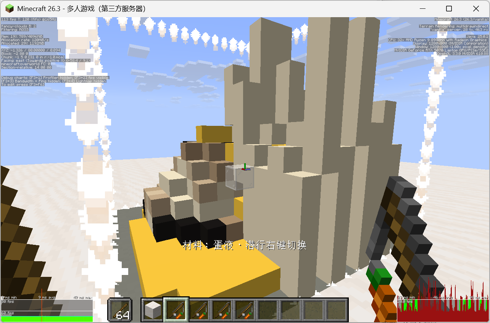
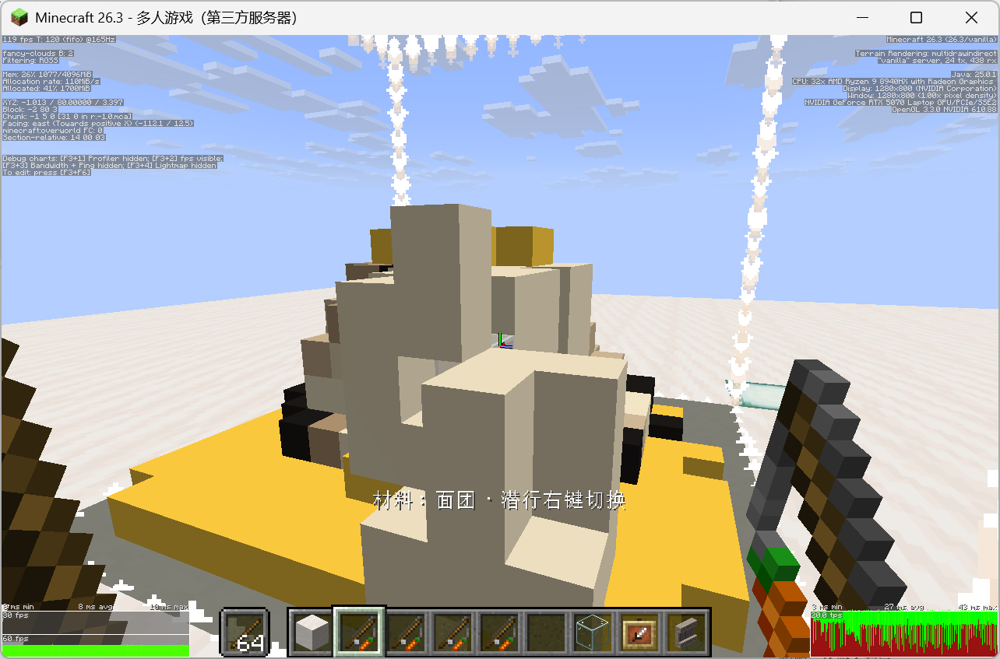

<FeatureHead
  title="基于 stopwatch 实现任务动态预算控制"
  authorName="伊桑桑桑桑桑"
/>

## 引子

开发数据包时，经常会遇到“批量计算”的场景。比如给 NPC 寻路、生成建筑，或者更新一大批正在模拟的物体。

如果把大量任务塞在一个 tick 里执行，就可能造成卡顿。所以，把它们分配到多个 tick 是很自然的想法。但任务分散之后，每个 tick 的耗时还是会高低起伏，游戏时不时就卡一下，对“强迫症”开发者十分不友好。

在开发“黑暗料理”这个数据包时，我就遇到了这种问题。

## 旧实现：每 tick 执行固定数量的任务

“黑暗料理”允许玩家像搭积木一样组装食材，把面团、蛋液等做成造型，然后放进烤箱烤制。料理还要计算流动、支撑、下落、传热和凝固。

“物理”这两个字一出现，我就预料到性能不会太好，尤其是对于 mcfunction 来说。于是初版就做了分刻：每 tick 只执行固定数量的任务，剩下的下一刻继续。

写完之后，看到右下角波浪形的火焰图，吐了一口老血。



明明已经把计算分散开了，为什么耗时还是这样忽高忽低？

## 为什么会出现这种波浪

原因是：**每 tick 执行的任务数量固定，但每个任务的开销不同。**

例如，面团相关任务要处理连通性、支撑和下落，蛋液相关任务要处理流动和重力。具体实现很复杂，这里简化成两类任务，假设轻任务（蛋液模拟）一次需要 **200μs**，重任务（面团模拟）一次需要 **800μs**。

如果每 tick 固定执行 10 个任务：

| 当前处理的任务 | 每 tick 的任务数 | 计算耗时 |
| --- | --- | --- |
| 轻任务（蛋液模拟） | 10 | 2ms |
| 重任务（面团模拟） | 10 | 8ms |

任务数量没变，耗时却差了四倍。

这些任务又是按计算阶段成批执行的：
- 连续几个 tick 都在处理轻任务，图上就是一段低谷。
- 接下来进入较重的计算阶段，图就抬高。

一轮计算中不断切换这些阶段，就形成了这种高低起伏的波浪。

所以，接下来要讨论的是如何给不同的任务分配时间。

## 按时间预算分配任务

给这批计算分配一个时间预算，比如每 tick **6ms**。

处理轻任务时，执行完一个还有很多预算，就继续拿下一个。

处理重任务时，每个任务用时更长，这一刻自然就少做几个。

每次任务还要记录一下实际用了多长时间，以免实际耗时和理论不一致。

每个 tick 的处理顺序就是：

1. 开始计时。
2. 检查已经用了多少时间。
3. 还有预算，就取出并执行一个任务，再回到第 2 步。
4. 达到预算，或者队列已经空了，就结束这一刻的处理。

下一刻重新计时，从剩下的任务继续。

这样，任务数量就能跟着开销变化。轻任务阶段多做一些，重任务阶段少做一些，让每 tick 分给这批工作的时间更均匀。

那么，怎么知道这一 tick 已经用了多久？

## 用 stopwatch 测量已用时间

本文使用 Minecraft Java 26.3 的 `stopwatch` 命令计时。

初始化时创建计时器：

```mcfunction
stopwatch create cooking:work
```

每 tick 开始处理任务前重置：

```mcfunction
stopwatch restart cooking:work
```

需要检查预算时，查询从重置到现在经过的时间：

```mcfunction
execute store result score wall_ms temp run stopwatch query cooking:work 1000
```

查询倍率 `1000` 对应毫秒，结果存进记分板后，`wall_ms` 就是已用的整数毫秒数。

## 大致的实现方式

我们可以先把每项工作写成一个 `{task:"a",cost:6}` 形式的 compound。`task` 表示要执行的工作，`cost` 表示预计耗时，这里的单位是毫秒。

再把这些记录放进 storage 里的一个列表，作为任务队列。

每 tick 开始时重新计时，然后从队列的第一项开始处理。每次准备执行任务前，查询 stopwatch，用本刻的总预算减去已用时间，就得到了剩余预算。根据任务的预计耗时，有三种处理方式：

1. **剩余预算够用：** 执行任务，完成后继续检查下一项。
2. **剩余预算不够，但一个完整 tick 的预算够用：** 任务留在队列里，本刻到此结束，下一刻再做。
3. **任务本身就超过一个 tick 的总预算：** 把它拆成几批，每次只做一部分。

### 1. 预算够用，执行后继续检查下一项

假如每 tick 的预算是 6ms，现在用了 2ms，下一项预计需要 0.8ms，剩余预算够用，就执行它。

做完后，再查询 stopwatch，重新计算剩余预算，然后判断下一项能不能做。这样，轻任务可以连续多做几项，重任务就少做几项。

### 2. 剩余预算不够，留到下一 tick

假如每 tick 的预算是 6ms，现在已经用了 5.5ms，下一个任务预计需要 0.8ms。如果直接开始，结束时就到了 6.3ms。

这里还剩 0.5ms，装不下这个任务，但下一刻重新分配的 6ms 够用。因此，把它留在队列里，结束本刻的处理，下一刻再做。

### 3. 任务本身太长，就分批处理

如果这个任务本身需要 20ms，即使下一刻从头开始，也放不进 6ms。所以要把任务拆开，分几次完成。分批后，按下一批的预计耗时判断预算。

比如，一个任务要检查 1000 个格子，可以这样处理：

1. 从第 1 格开始，每检查完一格，就看一下用了多久。
2. 时间用完时，假设刚检查完第 120 格，就记下下一次从第 121 格开始，结束本次执行。
3. 把记好进度的任务放回队列。之后再次轮到它，从第 121 格继续，直到全部检查完。

## 优化效果



优化后，轻任务阶段多做一些，重任务阶段少做一些，每 tick 的计算耗时更接近，图上原来成段的高低起伏也有所收敛。

## 使用时注意

**为下一项预留的时间需要按实测调整。** 留得太多，会提前结束本刻的处理；留得太少，任务容易超过剩余预算。

**队列顺序决定谁先执行。** 如果总把长任务的下一批排在最前面，其他工作就会一直等待。安排续做顺序时，也要考虑交互、渲染等工作的响应。

## 总结

这套方法适合可以分批执行、任务开销又不均匀的工作。动态任务预算的关键就是：**每刻给出时间额度，用 stopwatch 测量已经花掉的时间，再决定还做多少任务。**

虽然本文每 tick 预算是固定的，但实际使用时方法可以很灵活。比如可以根据运行负载弹性调整预算；允许当前任务略微超出预算等等。

---

**适用版本**：Minecraft Java 26.3  
