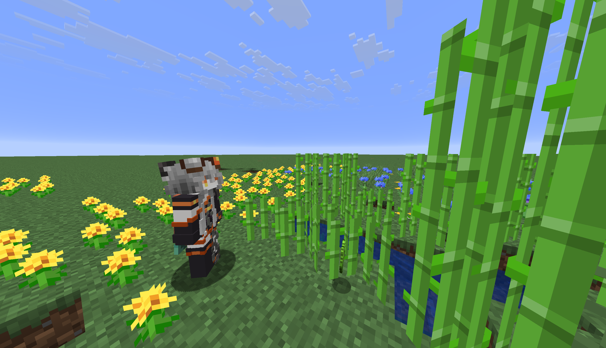
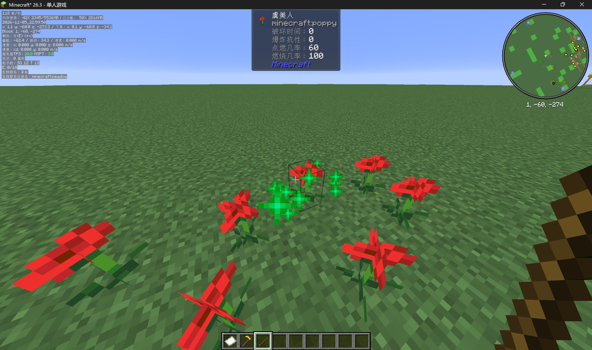
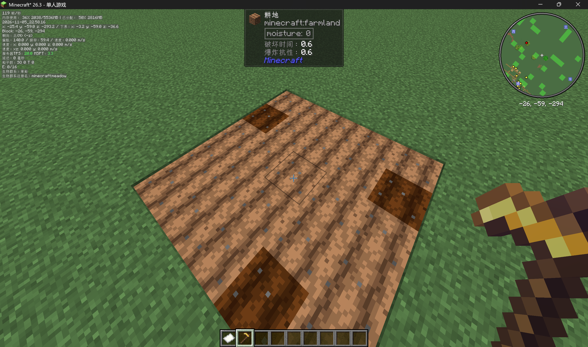
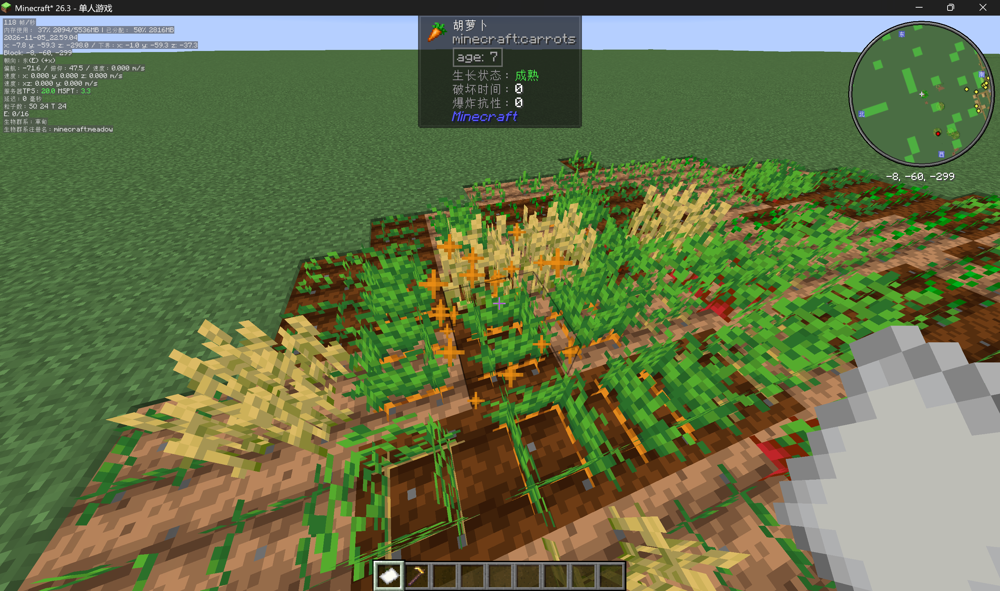

<FeatureHead
  title="从锄头到甘蔗催熟剂：block_transformer 还能这么玩？"
  authorName="晓舒迢"
  cover="../_asset/4/cover.png"
  resourceLink="../_asset/4/示例数据包.zip"
/>

> 摘要：本文从原版锄头入手，介绍 26.3 的 `block_transformer`，并结合甘蔗催熟剂、鲜花法杖、耕耘魔咒和金坷垃，讲解方块交互、进度、战利品表与地物的组合用法。

**`注意：本文使用了Deepseek v4.1 Flash辅助写作，已校对修改，数据包部分为纯人力手搓`**

在Minecraft 26.3版本中，mojang加入了一个新的物品组件 `minecraft:block_transformer`，这个新组件使物品具有与方块交互并进行处理的能力，比如锄头不再靠单独的 `HoeItem` 类处理耕地，而是 `minecraft:block_transformer` 组件指向的 `minecraft:hoe`。这个改动看起来只是把硬编码挪了个位置，实际用起来，能做的事情比“给工具加个右键转换方块的功能”多不少

下面先从原版锄头拆起，再拿甘蔗催熟剂走一遍完整流程。

示例数据包统一使用 `kks` 命名空间，下面会把文章实际用到的文件都贴出来，较长的 JSON 放在折叠块里。示例没有额外资源包，甘蔗催熟剂直接用纸的外观，鲜花法杖直接用木棍的外观

::: details 展开查看数据包目录

```text
kks/
├─ pack.mcmeta
└─ data/
   ├─ minecraft/
   │  └─ block_transformer/
   │     └─ hoe.json
   └─ kks/
      ├─ advancement/
      │  ├─ area_tillage.json
      │  ├─ used_flower_wand.json
      │  ├─ used_npk.json
      │  └─ used_sugar_cane_ripener.json
      ├─ block_transformer/
      │  ├─ can_used_on_any_block.json
      │  ├─ flower_wand.json
      │  ├─ npk.json
      │  └─ sugar_cane_ripener.json
      ├─ enchantment/
      │  └─ area_tillage.json
      ├─ function/
      │  ├─ place_flower_wand_feature.mcfunction
      │  ├─ place_hoe_feature.mcfunction
      │  ├─ place_npk_feature.mcfunction
      │  ├─ place_sugar_cane_feature.mcfunction
      │  ├─ used_area_tillage_hoe.mcfunction
      │  ├─ used_flower_wand.mcfunction
      │  ├─ used_npk.mcfunction
      │  └─ used_sugar_cane_ripener.mcfunction
      ├─ loot_table/
      │  ├─ flower_wand.json
      │  ├─ sugar_cane_ripener.json
      │  ├─ used_hoe.json
      │  └─ used_npk.json
      ├─ predicate/
      │  ├─ from_flower_wand.json
      │  ├─ from_hoe.json
      │  ├─ from_npk.json
      │  └─ from_sugar_cane_ripener.json
      └─ worldgen/
         └─ feature/
            ├─ area_tillage_lvl_1.json
            ├─ area_tillage_lvl_2.json
            ├─ area_tillage_lvl_3.json
            ├─ npk.json
            ├─ used_npk.json
            └─ used_sugar_cane_ripener.json
```

:::

## 一、拆一把原版锄头

`minecraft:hoe` 的规则文件在：

```text
data/minecraft/block_transformer/hoe.json
```

文件最外层是一个数组。数组里的每一项都是一套独立的转换逻辑，游戏会按顺序尝试，哪项先给出非空的目标方块状态，哪项就生效

锄头里最基本的一条规则大致是这样：

```json
{
  "block_state_provider": {
    "type": "minecraft:rule_based",
    "rules": [
      {
        "if_true": {
          "type": "minecraft:all_of",
          "predicates": [
            {
              "type": "minecraft:matching_block_tag",
              "tag": "minecraft:turns_into_farmland"
            },
            {
              "type": "minecraft:matching_block_tag",
              "tag": "minecraft:air",
              "offset": [0, 1, 0]
            }
          ]
        },
        "then": {
          "id": "minecraft:farmland",
          "properties": {
            "moisture": "0"
          }
        }
      }
    ]
  },
  "disallowed_faces": ["down"],
  "item_damage_per_use": 1,
  "sound": "minecraft:item.hoe.till"
}
```

`block_state_provider` 内联或引用一个方块状态提供器，负责判断当前方块符不符合条件，以及给出转换后的方块状态

这里的 `rule_based` 类型会从上往下检查规则。给出的片段要求被交互的方块属于 `#minecraft:turns_into_farmland`，且上方为空气，满足后返回耕地

再加上其他几个字段，转换器的大致行为就完整了：

- `disallowed_faces` 控制哪些点击面不能用。锄头禁止点击底面，所以从方块底下右键不会触发
- `item_damage_per_use` 是耐久损耗。锄头是不可堆叠物品，每次成功转换扣一点耐久
- `sound` 是转换成功后的音效
- `loot` 指定交互战利品表。锄头处理缠根泥土时用了 `minecraft:till/rooted_dirt`
- `drop_strategy` 决定战利品从哪边弹出，可选 `from_middle` 和 `clicked_face`。缠根泥土用的是后者
- `particle` 控制粒子，可选 `none`、`scrape`、`wax_on`、`wax_off`。锄头没写，所以没有额外粒子
- `consume_on_use` 控制可堆叠物品是否消耗一个，默认是 `true`
- `update_from_neighbors` 决定写入前要不要让邻居更新目标状态，默认开启
- `transform_type` 一般是 `single_block`，只有铜箱那种双格方块才用 `copper_chest`

## 二、方块状态提供器的奇妙用法

注意到 `copy_properties` 可以从一个来源状态复制方块和属性，而空的 `rule_based` 没有新状态可以提供，会退回当前方块状态。把这两个东西套在一起，结果就是：

```json
[
  {
    "block_state_provider": {
      "type": "minecraft:copy_properties",
      "source": {
        "type": "minecraft:rule_based",
        "rules": []
      }
    }
  }
]
```

目标方块还是原来那块，方块状态也没有变化，但转换器会认为这次转换成功

这一点很有用。以前要让普通物品对任意方块产生一次右键事件，往往得靠交互实体、消耗品或者别的触发器绕路；现在只要给物品挂上这个转换器，它就能对几乎所有方块右键“成功”一次，从而触发进度、战利品、音效或物品消耗

示例数据包里的 `kks:can_used_on_any_block` 就是这么写的，如果需要用条件筛选允许右键的方块，应该要这么写

```json
[
  {
    "block_state_provider": {
      "type": "minecraft:rule_based",
      "rules": [
        {
          "if_true": {"......"},
          "then": {
            "type": "minecraft:copy_properties",
            "source": {
              "type": "minecraft:rule_based",
              "rules": []
            }
          }
        }
      ]
    }
  }
]
```

另外，部分物品拥有自己的右键逻辑，或者方块本身抢先处理了交互，这个“万能右键”就轮不到了，后面会讲到

## 三、甘蔗催熟剂的思路

甘蔗催熟剂的逻辑类似骨粉，它不需要真的把甘蔗换成另一个方块，只需要判断这次右键是否合法，成功以后再由后面的函数让甘蔗长高



判断主要分成三层：

第一层是根部，交互的位置必须是甘蔗，下面必须是甘蔗能够生长的支撑方块：

```json
{
  "type": "minecraft:matching_blocks",
  "blocks": "minecraft:sugar_cane",
  "offset": [0, 0, 0]
},
{
  "type": "minecraft:matching_blocks",
  "blocks": "#minecraft:supports_sugar_cane",
  "offset": [0, -1, 0]
}
```

第二层是高度。用 `volume_match` 检查 `y+1` 和 `y+2`，如果两格同时都是甘蔗，说明总高度已经到 3，不产生交互：

```json
{
  "type": "minecraft:not",
  "predicate": {
    "type": "minecraft:volume_match",
    "min": [0, 1, 0],
    "max": [0, 2, 0],
    "match": {
      "type": "minecraft:matching_blocks",
      "blocks": "minecraft:sugar_cane"
    }
  }
}
```

第三层是生长空间，要求增长路径中出现方块时只能是空气或甘蔗。一格甘蔗时 `y+1` 要空着；两格甘蔗时 `y+2` 要空着，否则不会继续催熟

这三层条件都满足后，状态提供器返回的其实还是原甘蔗，只是转换器成功了一次。成功之后，`loot` 会生成一个看不见的标记物品。再用使用了`minecraft:any_block_use`准则的进度执行奖励函数：

```mcfunction
execute as @n[type=item,distance=..10,predicate=kks:from_sugar_cane_ripener] at @s run function kks:place_sugar_cane_feature

advancement revoke @s from kks:used_sugar_cane_ripener
```

这样就能用临时物品拿到方块坐标了

这里再单独说一下为什么不用 `minecraft:item_used_on_block` 准则

在 26.3 里，一次成功的 `block_transformer` 交互会让这个准则触发两次。一次在 `BlockTransformer.transformBlock()` 内部，转换成功时主动触发；另一次在 `ServerPlayerGameMode.useItemOn()` 里，物品成功使用后又会统一触发一次

如果奖励函数在末尾立刻撤销进度，第一次触发完成后再撤销，第二次触发就会把进度重新判定为未完成，再次执行奖励函数。函数里写一个 `say 1`，聊天栏里就会看到两句；放地物操作也会跟着执行两遍

如果继续用 `item_used_on_block`，就得把撤销延后到下一 tick。这样虽然也能用，但要额外维护 tag、计分板或者调度函数

`minecraft:any_block_use` 则只在交互完成后走一次，条件结构仍然是 `location` 里匹配工具组件和方块。对甘蔗催熟剂和鲜花法杖这类“转换器成功后再执行函数”的需求，用它更直接，也就不用给重复触发做补丁

还有一个边界情况，出在最后一个甘蔗催熟剂上

催熟剂用纸做载体，`consume_on_use` 为 `true`。当背包里只剩一个时，这次右键会先把物品消耗掉。`any_block_use` 在使用结束后才触发，此时工具已经是空物品；如果进度只匹配带有 `kks:sugar_cane_ripener` 组件的工具，就会匹配失败。奖励函数不执行，但转换器的战利品表已经生成了标记物品，于是地上又会留下一个无人清理的标记

修复方法是让进度匹配“正确的催熟剂”或“数量为 0 的空工具”：

```json
{
  "type": "minecraft:any_of",
  "terms": [
    {
      "type": "minecraft:match_tool",
      "predicate": {
        "components": {
          "minecraft:block_transformer": "kks:sugar_cane_ripener"
        }
      }
    },
    {
      "type": "minecraft:match_tool",
      "predicate": {
        "count": 0
      }
    }
  ]
}
```

::: details 展开查看甘蔗催熟剂完整实现

**`data/kks/block_transformer/sugar_cane_ripener.json`**

```json
[
  {
    "consume_on_use": true,
    "item_damage_per_use": 0,
    "drop_strategy": "from_middle",
    "particle": "wax_on",
    "sound": "minecraft:item.bone_meal.use",
    "loot": "kks:sugar_cane_ripener",
    "block_state_provider": {
      "type": "minecraft:rule_based",
      "rules": [
        {
          "if_true": {
            "type": "minecraft:all_of",
            "predicates": [
              {
                "type": "minecraft:matching_blocks",
                "blocks": "minecraft:sugar_cane",
                "offset": [0,0,0]
              },
              {
                "type": "minecraft:matching_blocks",
                "blocks": "#minecraft:supports_sugar_cane",
                "offset": [0,-1,0]
              },
              {
                "type": "minecraft:not",
                "predicate": {
                  "min": [0,1,0],
                  "max": [0,2,0],
                  "type": "minecraft:volume_match",
                  "match": {
                    "type": "minecraft:matching_blocks",
                    "blocks": "minecraft:sugar_cane"
                  }
                }
              },
              {
                "type": "minecraft:not",
                "predicate": {
                  "type": "minecraft:all_of",
                  "predicates": [
                    {
                      "type": "minecraft:matching_blocks",
                      "blocks": "minecraft:sugar_cane",
                      "offset": [0,1,0]
                    },
                    {
                      "type": "minecraft:not",
                      "predicate": {
                        "type": "minecraft:matching_blocks",
                        "blocks": [
                          "minecraft:air",
                          "minecraft:sugar_cane"
                        ],
                        "offset": [0,2,0]
                      }
                    }
                  ]
                }
              },
              {
                "type": "minecraft:not",
                "predicate": {
                  "type": "minecraft:all_of",
                  "predicates": [
                    {
                      "type": "minecraft:matching_blocks",
                      "blocks": "minecraft:sugar_cane",
                      "offset": [0,0,0]
                    },
                    {
                      "type": "minecraft:not",
                      "predicate": {
                        "type": "minecraft:matching_blocks",
                        "blocks": [
                          "minecraft:air",
                          "minecraft:sugar_cane"
                        ],
                        "offset": [0,1,0]
                      }
                    }
                  ]
                }
              }
            ]
          },
          "then": {
            "type": "minecraft:copy_properties",
            "source": {
              "type": "minecraft:rule_based",
              "rules": []
            }
          }
        }
      ]
    }
  }
]
```

**`data/kks/loot_table/sugar_cane_ripener.json`**

```json
{
  "pools": [
    {
      "rolls": 1,
      "entries": [
        {
          "type": "minecraft:alternatives",
          "children": [
            {
              "type": "minecraft:item",
              "name": "minecraft:test_block",
              "modifier": {
                "type": "minecraft:set_components",
                "components": {
                  "minecraft:item_model": "minecraft:air",
                  "minecraft:custom_data": {
                    "id": "kks:from_sugar_cane_ripener"
                  }
                }
              },
              "condition": {
                "type": "minecraft:match_block",
                "blocks": "minecraft:sugar_cane"
              }
            },
            {
              "type": "minecraft:item",
              "name": "minecraft:paper",
              "modifier": {
                "type": "minecraft:set_components",
                "components": {
                  "minecraft:item_name": "甘蔗催熟剂",
                  "minecraft:block_transformer": "kks:sugar_cane_ripener"
                }
              }
            }
          ]
        }
      ]
    }
  ]
}
```

**`data/kks/predicate/from_sugar_cane_ripener.json`**

```json
{
  "type": "minecraft:entity_properties",
  "entity": "this",
  "predicate": {
    "minecraft:slots": {
      "contents": {
        "items": "minecraft:test_block",
        "predicates": {
          "minecraft:custom_data": {
            "id": "kks:from_sugar_cane_ripener"
          }
        }
      }
    }
  }
}
```

**`data/kks/advancement/used_sugar_cane_ripener.json`**

```json
{
  "criteria": {
    "1": {
      "trigger": "minecraft:any_block_use",
      "conditions": {
        "location": {
          "type": "minecraft:all_of",
          "terms": [
            {
              "type": "minecraft:any_of",
              "terms": [
                {
                  "type": "minecraft:match_tool",
                  "predicate": {
                    "components": {
                      "minecraft:block_transformer": "kks:sugar_cane_ripener"
                    }
                  }
                },
                {
                  "type": "minecraft:match_tool",
                  "predicate": {
                    "count": 0
                  }
                }
              ]
            },
            {
              "type": "minecraft:match_block",
              "blocks": "minecraft:sugar_cane"
            }
          ]
        }
      }
    }
  },
  "rewards": {
    "function": "kks:used_sugar_cane_ripener"
  }
}
```

**`data/kks/function/used_sugar_cane_ripener.mcfunction`**

```mcfunction
execute as @n[type=item,distance=..10,predicate=kks:from_sugar_cane_ripener] at @s run function kks:place_sugar_cane_feature

advancement revoke @s from kks:used_sugar_cane_ripener
```

**`data/kks/function/place_sugar_cane_feature.mcfunction`**

```mcfunction
place feature kks:used_sugar_cane_ripener

kill @s
```

:::

## 四、为什么不用骨粉

我一开始也觉得，最顺手的做法就是直接给 `minecraft:bone_meal` 加组件。结果不行

26.3 的 `BoneMealItem` 会先尝试原版催熟，失败后直接返回 `PASS`不进入基类 `Item.useOn`。而 `block_transformer` 恰好是在基类里处理的，所以骨粉会绕开组件

这不是json写错了，而是骨粉根本没走到那条路

示例最后用了纸：

```mcfunction
give @s minecraft:paper[minecraft:item_name="甘蔗催熟剂",minecraft:block_transformer="kks:sugar_cane_ripener"]
```

纸没有自己的右键逻辑，能稳定进入通用流程，它被做成催熟剂后只充当触发器，后续效果由进度，函数等补上

顺手还能让战利品表兼职做物品工厂，战利品表`kks:sugar_cane_ripener` 在`block_transformer`里运行时，会生成标记物品；用/loot命令时没有方块上下文，会直接获取催熟剂本身

```mcfunction
loot give @s loot kks:sugar_cane_ripener
```

## 五、地物怎么写

真正让甘蔗长高的是地物,由进度函数在标记位置调用：

```mcfunction
place feature kks:used_sugar_cane_ripener

kill @s
```

地物文件则放在：

```text
data/kks/worldgen/feature/used_sugar_cane_ripener.json
```

地物的根节点是 `minecraft:sequence`。它先给执行位置加一个 `minecraft:offset`向上偏移一格，再执行 `minecraft:random_selector`

`minecraft:random_selector`有两个分支：

- 30% 概率 `minecraft:block_column`，尝试一次放两格甘蔗
- 其余情况 `minecraft:simple_block`，只放一格

`block_column` 里的 `allowed_placement` 会检查目标位置是不是空气。它适合处理一格甘蔗直接长到三格的情况；如果当前位置不是空的，这次分支就不会真的放下方块

另一边的 `simple_block` 用了 `minecraft:environment_scan`：

```json
{
  "type": "minecraft:environment_scan",
  "direction_of_search": "up",
  "max_steps": 2,
  "target_condition": {
    "type": "minecraft:all_of",
    "predicates": [
      {
        "type": "minecraft:matching_blocks",
        "blocks": "minecraft:sugar_cane",
        "offset": [0, -1, 0]
      },
      {
        "type": "minecraft:matching_blocks",
        "blocks": "#minecraft:air",
        "offset": [0, 0, 0]
      }
    ]
  }
}
```

它的作用是从当前位置向上最多找两格，找到“下面是甘蔗、自己又是空气”的位置，再把甘蔗放上去。这样一来就不用在函数里判断当前甘蔗到底有多高，地物自己会找到正确的放置点

::: details 展开查看

**`data/kks/worldgen/feature/used_sugar_cane_ripener.json`**

```json
{
  "type": "minecraft:sequence",
  "features": [
    {
      "placement": [
        {
          "type": "minecraft:offset",
          "x": 0,
          "y": 1,
          "z": 0
        }
      ],
      "feature": {
        "type": "minecraft:random_selector",
        "features": [
          {
            "chance": 0.30,
            "feature": {
              "placement": [],
              "feature": {
                "type": "minecraft:block_column",
                "prioritize_tip": false,
                "direction": "up",
                "allowed_placement": {
                  "type": "minecraft:matching_blocks",
                  "blocks": "#minecraft:air"
                },
                "layers": [
                  {
                    "height": 2,
                    "provider": {
                      "id": "minecraft:sugar_cane"
                    }
                  }
                ]
              }
            }
          }
        ],
        "default": {
          "feature": {
            "type": "minecraft:simple_block",
            "to_place": {
              "id": "minecraft:sugar_cane"
            }
          },
          "placement": [
            {
              "type": "minecraft:environment_scan",
              "direction_of_search": "up",
              "max_steps": 2,
              "target_condition": {
                "type": "minecraft:all_of",
                "predicates": [
                  {
                    "type": "minecraft:matching_blocks",
                    "blocks": "minecraft:sugar_cane",
                    "offset": [0,-1,0]
                  },
                  {
                    "type": "minecraft:matching_blocks",
                    "blocks": "#minecraft:air",
                    "offset": [0,0,0]
                  }
                ]
              }
            }
          ]
        }
      }
    }
  ]
}
```

:::

## 六、举一反三，更多应用实例

### 鲜花法杖

鲜花法杖的载体是木棍，耐久 50，只堆叠 1 个。这里要注意，`max_damage` 和 `max_stack_size` 要一起写，不然物品会同时被判定为可堆叠和可损坏



获取它还是走战利品表：

```mcfunction
loot give @s loot kks:flower_wand
```

没有方块上下文时，表里的回退项生成木棍，并补上名字、`block_transformer`、耐久和堆叠数。到这里拿到的就是鲜花法杖本体

它的方块状态提供器只接受 `#minecraft:small_flowers`，并排除了金蒲公英、凋灵玫瑰和火把花，同时要求花朵下方不是空气。满足后仍然是一次空转换，再用 `loot` 生成标记物品

这张战利品表会在标记的 `custom_data` 里写入 `id` 和 `type`。`type` 就是被点击花朵的方块 ID，后面要根据它决定生成哪一种花。因为战利品表没法直接从方块状态里取 ID，所以这里只能把允许的花朵逐个列出来，用 `match_block` 条件写进不同的 `set_custom_data`

进度准则用的是 `minecraft:any_block_use`，条件仍然是工具组件和 `#minecraft:small_flowers`。奖励函数找到标记后，把整个 `custom_data` 传给宏：

```mcfunction
execute as @n[type=item,distance=..10,predicate=kks:from_flower_wand] at @s run function kks:place_flower_wand_feature with entity @s Item.components."minecraft:custom_data"
```

宏函数里用 `$(type)` 放进地物状态提供器，使用 `minecraft:disk` 地物类型。它会以点击位置为中心生成半径 2、半高 0 的圆盘，状态提供器按 1:4 在“被点击的花”和空气之间抽取，所以不是每个位置都会长花。目标谓词同时要求方块是空气或可替换方块，并且该位置能让花存活，避免把其他方块换掉

这里还有一个耐久边界要注意

`minecraft:any_block_use` 是在物品使用完成后才触发，而 `block_transformer` 的掉落处理在它之前。法杖只剩 1 点耐久时使用会先把法杖耐久清零然后碎掉，进度条件拿不到带 `block_transformer` 组件的工具，奖励函数不会执行；但战利品表已经把标记物品生成出来了，于是地上会留下一个标记

修复要在战利品表这一层做，让 `match_tool` 读取这次交互使用的工具剩余耐久至少 2 ，这样最后一用只会让法杖损坏，不会生成无人处理的标记：

```json
{
  "type": "minecraft:match_tool",
  "predicate": {
    "predicates": {
      "minecraft:damage": {
        "durability": {
          "min": 2
        }
      }
    }
  }
}
```

::: details 展开查看鲜花法杖的完整实现

**`data/kks/block_transformer/flower_wand.json`**

```json
[
  {
    "consume_on_use": false,
    "item_damage_per_use": 1,
    "drop_strategy": "from_middle",
    "sound": "minecraft:item.bone_meal.use",
    "transform_type": "single_block",
    "loot": "kks:flower_wand",
    "block_state_provider": {
      "type": "minecraft:rule_based",
      "rules": [
        {
          "if_true": {
            "type": "minecraft:all_of",
            "predicates": [
              {
                "type": "minecraft:matching_blocks",
                "blocks": "#minecraft:small_flowers",
                "offset": [0,0,0]
              },
              {
                "type": "minecraft:not",
                "predicate": {
                  "type": "minecraft:matching_blocks",
                  "blocks": [
                    "minecraft:golden_dandelion",
                    "minecraft:wither_rose",
                    "minecraft:torchflower"
                  ],
                  "offset": [0,0,0]
                }
              },
              {
                "type": "minecraft:not",
                "predicate": {
                  "type": "minecraft:matching_blocks",
                  "blocks": "#minecraft:air",
                  "offset": [0,-1,0]
                }
              }
            ]
          },
          "then": {
            "type": "minecraft:copy_properties",
            "source": {
              "type": "minecraft:rule_based",
              "rules": []
            }
          }
        }
      ]
    }
  }
]
```

**`data/kks/predicate/from_flower_wand.json`**

```json
{
  "type": "minecraft:entity_properties",
  "entity": "this",
  "predicate": {
    "minecraft:slots": {
      "contents": {
        "items": "minecraft:test_block",
        "predicates": {
          "minecraft:custom_data": {
            "id": "kks:from_flower_wand"
          }
        }
      }
    }
  }
}
```

**`data/kks/advancement/used_flower_wand.json`**

```json
{
  "criteria": {
    "1": {
      "trigger": "minecraft:any_block_use",
      "conditions": {
        "location": {
          "type": "minecraft:all_of",
          "terms": [
            {
              "type": "minecraft:match_tool",
              "predicate": {
                "components": {
                  "minecraft:block_transformer": "kks:flower_wand"
                }
              }
            },
            {
              "type": "minecraft:match_block",
              "blocks": "#minecraft:small_flowers"
            }
          ]
        }
      }
    }
  },
  "rewards": {
    "function": "kks:used_flower_wand"
  }
}
```

**`data/kks/function/used_flower_wand.mcfunction`**

```mcfunction
execute as @n[type=item,distance=..10,predicate=kks:from_flower_wand] at @s run function kks:place_flower_wand_feature with entity @s Item.components."minecraft:custom_data"

advancement revoke @s from kks:used_flower_wand
```

**`data/kks/function/place_flower_wand_feature.mcfunction`**

```mcfunction
particle happy_villager ~ ~ ~ 0.3 0.3 0.3 0.2 12

$place feature {type:"minecraft:disk",state_provider:{type:"minecraft:weighted",entries:[{weight:1,data:"$(type)"},{weight:4,data:"minecraft:air"}]},radius:2,half_height:0,target:{type:"minecraft:all_of",predicates:[{type:"minecraft:would_survive",state:"minecraft:poppy"},{type:"minecraft:any_of",predicates:[{type:"minecraft:matching_blocks",blocks:"#minecraft:air"},{type:"minecraft:replaceable"}]}]}}

kill @s
```

:::

::: details 展开查看 flower_wand.json 战利品表

```json
{
  "type": "minecraft:block_interact",
  "pools": [
    {
      "rolls": 1,
      "entries": [
        {
          "type": "minecraft:alternatives",
          "children": [
            {
              "type": "minecraft:item",
              "name": "minecraft:test_block",
              "modifier": [
                {
                  "type": "minecraft:set_components",
                  "components": {
                    "minecraft:item_model": "minecraft:air",
                    "minecraft:custom_data": {
                      "id": "kks:from_flower_wand"
                    }
                  }
                },
                {
                  "type": "minecraft:set_custom_data",
                  "tag": {
                    "type": "minecraft:dandelion"
                  },
                  "condition": {
                    "type": "minecraft:match_block",
                    "blocks": "minecraft:dandelion"
                  }
                },
                {
                  "type": "minecraft:set_custom_data",
                  "tag": {
                    "type": "minecraft:open_eyeblossom"
                  },
                  "condition": {
                    "type": "minecraft:match_block",
                    "blocks": "minecraft:open_eyeblossom"
                  }
                },
                {
                  "type": "minecraft:set_custom_data",
                  "tag": {
                    "type": "minecraft:poppy"
                  },
                  "condition": {
                    "type": "minecraft:match_block",
                    "blocks": "minecraft:poppy"
                  }
                },
                {
                  "type": "minecraft:set_custom_data",
                  "tag": {
                    "type": "minecraft:blue_orchid"
                  },
                  "condition": {
                    "type": "minecraft:match_block",
                    "blocks": "minecraft:blue_orchid"
                  }
                },
                {
                  "type": "minecraft:set_custom_data",
                  "tag": {
                    "type": "minecraft:allium"
                  },
                  "condition": {
                    "type": "minecraft:match_block",
                    "blocks": "minecraft:allium"
                  }
                },
                {
                  "type": "minecraft:set_custom_data",
                  "tag": {
                    "type": "minecraft:azure_bluet"
                  },
                  "condition": {
                    "type": "minecraft:match_block",
                    "blocks": "minecraft:azure_bluet"
                  }
                },
                {
                  "type": "minecraft:set_custom_data",
                  "tag": {
                    "type": "minecraft:red_tulip"
                  },
                  "condition": {
                    "type": "minecraft:match_block",
                    "blocks": "minecraft:red_tulip"
                  }
                },
                {
                  "type": "minecraft:set_custom_data",
                  "tag": {
                    "type": "minecraft:orange_tulip"
                  },
                  "condition": {
                    "type": "minecraft:match_block",
                    "blocks": "minecraft:orange_tulip"
                  }
                },
                {
                  "type": "minecraft:set_custom_data",
                  "tag": {
                    "type": "minecraft:white_tulip"
                  },
                  "condition": {
                    "type": "minecraft:match_block",
                    "blocks": "minecraft:white_tulip"
                  }
                },
                {
                  "type": "minecraft:set_custom_data",
                  "tag": {
                    "type": "minecraft:pink_tulip"
                  },
                  "condition": {
                    "type": "minecraft:match_block",
                    "blocks": "minecraft:pink_tulip"
                  }
                },
                {
                  "type": "minecraft:set_custom_data",
                  "tag": {
                    "type": "minecraft:oxeye_daisy"
                  },
                  "condition": {
                    "type": "minecraft:match_block",
                    "blocks": "minecraft:oxeye_daisy"
                  }
                },
                {
                  "type": "minecraft:set_custom_data",
                  "tag": {
                    "type": "minecraft:cornflower"
                  },
                  "condition": {
                    "type": "minecraft:match_block",
                    "blocks": "minecraft:cornflower"
                  }
                },
                {
                  "type": "minecraft:set_custom_data",
                  "tag": {
                    "type": "minecraft:lily_of_the_valley"
                  },
                  "condition": {
                    "type": "minecraft:match_block",
                    "blocks": "minecraft:lily_of_the_valley"
                  }
                },
                {
                  "type": "minecraft:set_custom_data",
                  "tag": {
                    "type": "minecraft:closed_eyeblossom"
                  },
                  "condition": {
                    "type": "minecraft:match_block",
                    "blocks": "minecraft:closed_eyeblossom"
                  }
                }
              ],
              "condition": {
                "type": "minecraft:all_of",
                "terms": [
                  {
                    "type": "minecraft:match_block",
                    "blocks": "#minecraft:small_flowers"
                  },
                  {
                    "type": "minecraft:match_tool",
                    "predicate": {
                      "predicates": {
                        "minecraft:damage": {
                          "durability": {
                            "min": 2
                          }
                        }
                      }
                    }
                  }
                ]
              }
            },
            {
              "type": "minecraft:item",
              "name": "minecraft:stick",
              "modifier": {
                "type": "minecraft:set_components",
                "components": {
                  "minecraft:item_name": "花朵法杖",
                  "minecraft:block_transformer": "kks:flower_wand",
                  "minecraft:max_damage": 50,
                  "minecraft:damage": 0,
                  "minecraft:max_stack_size": 1
                }
              },
              "condition": {
                "type": "minecraft:inverted",
                "term": {
                  "type": "minecraft:match_block"
                }
              }
            }
          ]
        }
      ]
    }
  ]
}
```

:::

### 范围耕地魔咒“耕耘”

这个例子没有再新建一件物品，而是直接给原版锄头加一个新附魔，魔咒的效果逻辑全部放在 `block_transformer` `worldgen/feature`等注册表内



数据包会覆盖 `data/minecraft/block_transformer/hoe.json`。覆盖原版文件时必须把原版两组转换都完整抄下来，只在第一组加上 `loot` 和 `drop_strategy`

触发顺序是这样的：原版锄头先把方块耕成耕地，`block_transformer` 在返回前调用 `kks:used_hoe`。这张战利品表会检查工具是否带有 `kks:area_tillage` 附魔，并检查旧方块是否属于 `#minecraft:turns_into_farmland`。没附魔的锄头也会经过这里，但不会生成标记

真正的进度用 `any_block_use`，并且匹配的是交互结束后的 `minecraft:farmland`。也就是说，只有确实把方块耕成耕地时才会触发范围效果。工具条件里保留了 `count: 0` ，用来处理锄头在最后一格耐久时直接损坏的情况

等级没有另外拆三套进度，而是塞进了标记物品的 `custom_model_data`。战利品表用 `set_custom_model_data` 的 `number_dispatcher` 给一、二级分别写入 `1.0f` 和 `2.0f`，其余情况默认写 `3.0f`，函数再检查标记物品的这几个值，选择对应的地物

三级范围分别对应 1×1、3×3 和 5×5。一级直接覆盖被点击的耕地并把湿度设为 7；二、三级分别把湿度随机到 5–7 和 4–7，并通过 `offset` 和 `cuboid` 展开范围，再用 `block_predicate_filter` 只保留“当前方块能变成耕地、上方是空气”的位置。中心方块已经被原版锄头变成耕地，所以后两级实际补的是周围可耕区域

::: details 展开查看“耕耘”附魔、进度、战利品和函数

**`data/minecraft/block_transformer/hoe.json`**

```json
[
  {
    "block_state_provider": {
      "type": "minecraft:rule_based",
      "rules": [
        {
          "if_true": {
            "type": "minecraft:all_of",
            "predicates": [
              {
                "type": "minecraft:matching_block_tag",
                "tag": "minecraft:turns_into_farmland"
              },
              {
                "type": "minecraft:matching_block_tag",
                "offset": [0,1,0],
                "tag": "minecraft:air"
              }
            ]
          },
          "then": {
            "id": "minecraft:farmland",
            "properties": {
              "moisture": "0"
            }
          }
        },
        {
          "if_true": {
            "type": "minecraft:all_of",
            "predicates": [
              {
                "type": "minecraft:matching_blocks",
                "blocks": "minecraft:coarse_dirt"
              },
              {
                "type": "minecraft:matching_block_tag",
                "offset": [0,1,0],
                "tag": "minecraft:air"
              }
            ]
          },
          "then": {
            "id": "minecraft:dirt"
          }
        }
      ]
    },
    "disallowed_faces": ["down"],
    "loot": "kks:used_hoe",
    "drop_strategy": "from_middle",
    "item_damage_per_use": 1,
    "sound": "minecraft:item.hoe.till"
  },
  {
    "block_state_provider": {
      "type": "minecraft:rule_based",
      "rules": [
        {
          "if_true": {
            "type": "minecraft:matching_blocks",
            "blocks": "minecraft:rooted_dirt"
          },
          "then": {
            "id": "minecraft:dirt"
          }
        }
      ]
    },
    "drop_strategy": "clicked_face",
    "item_damage_per_use": 1,
    "loot": "minecraft:till/rooted_dirt",
    "sound": "minecraft:item.hoe.till"
  }
]
```

**`data/kks/enchantment/area_tillage.json`**

```json
{
  "description": "耕耘",
  "supported_items": "#minecraft:hoes",
  "weight": 1,
  "max_level": 3,
  "min_cost": {
    "base": 15,
    "per_level_above_first": 10
  },
  "max_cost": {
    "base": 15,
    "per_level_above_first": 10
  },
  "anvil_cost": 2,
  "slots": ["mainhand"],
  "effects": {}
}
```

**`data/kks/advancement/area_tillage.json`**

```json
{
  "criteria": {
    "1": {
      "trigger": "minecraft:any_block_use",
      "conditions": {
        "location": {
          "type": "minecraft:all_of",
          "terms": [
            {
              "type": "minecraft:any_of",
              "terms": [
                {
                  "type": "minecraft:match_tool",
                  "predicate": {
                    "items": "#minecraft:hoes",
                    "predicates": {
                      "minecraft:enchantments": [
                        {
                          "enchantments": "kks:area_tillage"
                        }
                      ]
                    }
                  }
                },
                {
                  "type": "minecraft:match_tool",
                  "predicate": {
                    "count": 0
                  }
                }
              ]
            },
            {
              "type": "minecraft:match_block",
              "blocks": "minecraft:farmland"
            }
          ]
        }
      }
    }
  },
  "rewards": {
    "function": "kks:used_area_tillage_hoe"
  }
}
```

**`data/kks/loot_table/used_hoe.json`**

```json
{
  "pools": [
    {
      "rolls": 1,
      "entries": [
        {
          "type": "minecraft:item",
          "name": "minecraft:test_block",
          "modifier": [
            {
              "type": "minecraft:set_components",
              "components": {
                "minecraft:item_model": "minecraft:air",
                "minecraft:custom_data": {
                  "id": "kks:from_hoe"
                }
              }
            },
            {
              "type": "minecraft:set_custom_model_data",
              "floats": {
                "mode": "append",
                "values": [
                  {
                    "type": "minecraft:number_dispatcher",
                    "default": 3,
                    "cases": [
                      {
                        "value": 1,
                        "condition": {
                          "type": "minecraft:match_tool",
                          "predicate": {
                            "predicates": {
                              "minecraft:enchantments": [
                                {
                                  "enchantments": "kks:area_tillage",
                                  "levels": 1
                                }
                              ]
                            }
                          }
                        }
                      },
                      {
                        "value": 2,
                        "condition": {
                          "type": "minecraft:match_tool",
                          "predicate": {
                            "predicates": {
                              "minecraft:enchantments": [
                                {
                                  "enchantments": "kks:area_tillage",
                                  "levels": 2
                                }
                              ]
                            }
                          }
                        }
                      }
                    ]
                  }
                ]
              }
            }
          ],
          "condition": {
            "type": "minecraft:all_of",
            "terms": [
              {
                "type": "minecraft:match_tool",
                "predicate": {
                  "predicates": {
                    "minecraft:enchantments": [
                      {
                        "enchantments": "kks:area_tillage"
                      }
                    ]
                  }
                }
              },
              {
                "type": "minecraft:match_block",
                "blocks": "#minecraft:turns_into_farmland"
              }
            ]
          }
        }
      ]
    }
  ]
}
```

**`data/kks/predicate/from_hoe.json`**

```json
{
  "type": "minecraft:entity_properties",
  "entity": "this",
  "predicate": {
    "minecraft:slots": {
      "contents": {
        "items": "minecraft:test_block",
        "predicates": {
          "minecraft:custom_data": {
            "id": "kks:from_hoe"
          }
        }
      }
    }
  }
}
```

**`data/kks/function/used_area_tillage_hoe.mcfunction`**

```mcfunction
execute as @n[type=item,distance=..10,predicate=kks:from_hoe] at @s run function kks:place_hoe_feature

advancement revoke @s from kks:area_tillage
```

**`data/kks/function/place_hoe_feature.mcfunction`**

```mcfunction
execute if predicate \
    {type:entity_properties,entity:this,predicate:{slots:{contents:{components:{custom_model_data:{floats:[1.0f]}}}}}} run \
        place feature kks:area_tillage_lvl_1

execute if predicate \
    {type:entity_properties,entity:this,predicate:{slots:{contents:{components:{custom_model_data:{floats:[2.0f]}}}}}} run \
        place feature kks:area_tillage_lvl_2

execute if predicate \
    {type:entity_properties,entity:this,predicate:{slots:{contents:{components:{custom_model_data:{floats:[3.0f]}}}}}} run \
        place feature kks:area_tillage_lvl_3


kill @s
```

:::

::: details 展开查看三级范围耕地地物

**`data/kks/worldgen/feature/area_tillage_lvl_1.json`**

```json
{
  "type": "minecraft:simple_block",
  "to_place": {
    "type": "minecraft:randomized_int",
    "property": "moisture",
    "source": {
      "id": "minecraft:farmland"
    },
    "values": 7
  }
}
```

**`data/kks/worldgen/feature/area_tillage_lvl_2.json`**

```json
{
  "type": "minecraft:sequence",
  "features": [
    {
      "feature": {
        "type": "minecraft:simple_block",
        "to_place": {
          "type": "minecraft:randomized_int",
          "property": "moisture",
          "source": {
            "id": "minecraft:farmland"
          },
          "values": {
            "type": "minecraft:uniform",
            "min_inclusive": 5,
            "max_inclusive": 7
          }
        }
      },
      "placement": [
        {
          "type": "minecraft:offset",
          "x": -1,
          "y": 0,
          "z": -1
        },
        {
          "type": "minecraft:cuboid",
          "xz_size": 2,
          "y_size": 1
        },
        {
          "type": "minecraft:block_predicate_filter",
          "predicate": {
            "type": "minecraft:all_of",
            "predicates": [
              {
                "type": "minecraft:matching_blocks",
                "blocks": "#minecraft:turns_into_farmland"
              },
              {
                "type": "minecraft:matching_blocks",
                "blocks": "#minecraft:air",
                "offset": [0,1,0]
              }
            ]
          }
        }
      ]
    }
  ]
}
```

**`data/kks/worldgen/feature/area_tillage_lvl_3.json`**

```json
{
  "type": "minecraft:sequence",
  "features": [
    {
      "feature": {
        "type": "minecraft:simple_block",
        "to_place": {
          "type": "minecraft:randomized_int",
          "property": "moisture",
          "source": {
            "id": "minecraft:farmland"
          },
          "values": {
            "type": "minecraft:uniform",
            "min_inclusive": 4,
            "max_inclusive": 7
          }
        }
      },
      "placement": [
        {
          "type": "minecraft:offset",
          "x": -2,
          "y": 0,
          "z": -2
        },
        {
          "type": "minecraft:cuboid",
          "xz_size": 4,
          "y_size": 1
        },
        {
          "type": "minecraft:block_predicate_filter",
          "predicate": {
            "type": "minecraft:all_of",
            "predicates": [
              {
                "type": "minecraft:matching_blocks",
                "blocks": "#minecraft:turns_into_farmland"
              },
              {
                "type": "minecraft:matching_blocks",
                "blocks": "#minecraft:air",
                "offset": [0,1,0]
              }
            ]
          }
        }
      ]
    }
  ]
}
```

:::

### 范围骨粉“金坷垃”

金坷垃用的还是纸载体，`consume_on_use` 为 `true`，右键一次消耗一个。它不直接修改作物，而是先确认点击的是小麦、胡萝卜、马铃薯或甜菜根，并且脚下是耕地，再用空转换触发战利品表和进度



触发条件写在 `kks:npk` 的方块状态提供器里；进度再用 `any_block_use` 匹配同类作物。工具条件同样保留了 `count: 0`，所以最后一个金坷垃被消耗后，奖励函数仍能正常接上

进度函数通过标记物品拿到点击位置，然后执行 `kks:used_npk`。这个地物是一个 `minecraft:overlay`，本身不直接放方块，只负责在多个位置分别叠放一次 `kks:npk`

范围由两部分组成：先偏移 `[-1, 0, -1]` 后用 `cuboid` 扫出中心 3×3；再向东、西、南北各补一格距离 2 的位置。总共最多 13 个位置。每个位置都会先检查下方是不是耕地，再交给 `kks:npk` 处理，因此空位、别的地物方块和不合格的支撑方块都会被跳过

真正的催熟逻辑在 `kks:npk` 里。它用 `random_selector` 分成四个等概率分支，分别代表原版随机增量 2、3、4、5。每个分支再穷举所有未成熟年龄：小麦、胡萝卜、马铃薯是 0～6，甜菜根是 0～2。小麦、胡萝卜、马铃薯的新年龄是 `min(7, age + roll)`，甜菜根则是 `min(3, age + floor(roll / 3))`

这里作物的方块状态修改选用 `replace_single_block`，而不是 `simple_block` ，关键在于它直接表达“原方块状态 → 目标方块状态”的映射。`targets` 里每一项都由一个 `RuleTest` 和一个目标 `BlockState` 组成，比如“小麦 age 3 → 小麦 age 5”。地物会按顺序检查，遇到第一条匹配的规则就原地替换，后面的规则不再执行

因为每个位置的 `random_selector` 都独立抽一次，所以 13 个作物不会同步成长，而是各自得到自己的随机结果。成熟作物没有写进替换目标，地物不会改变它们；不过当前方块状态提供器没有读取方块状态的功能，所以对成熟作物使用仍会消耗一个金坷垃

::: details 展开查看金坷垃的物品、进度、范围和触发文件

**`data/kks/block_transformer/npk.json`**

```json
[
  {
    "consume_on_use": true,
    "item_damage_per_use": 0,
    "sound": "minecraft:item.bone_meal.use",
    "particle": "wax_on",
    "loot": "kks:used_npk",
    "drop_strategy": "from_middle",
    "disallowed_faces": ["down"],
    "block_state_provider": {
      "type": "minecraft:rule_based",
      "rules": [
        {
          "if_true": {
            "type": "minecraft:all_of",
            "predicates": [
              {
                "type": "minecraft:matching_blocks",
                "blocks": [
                  "minecraft:wheat",
                  "minecraft:carrots",
                  "minecraft:potatoes",
                  "minecraft:beetroots"
                ]
              },
              {
                "type": "minecraft:matching_blocks",
                "blocks": "minecraft:farmland",
                "offset": [0,-1,0]
              }
            ]
          },
          "then": {
            "type": "minecraft:copy_properties",
            "source": {
              "type": "minecraft:rule_based",
              "rules": []
            }
          }
        }
      ]
    }
  }
]
```

**`data/kks/loot_table/used_npk.json`**

```json
{
  "pools": [
    {
      "rolls": 1,
      "entries": [
        {
          "type": "minecraft:alternatives",
          "children": [
            {
              "type": "minecraft:item",
              "name": "minecraft:test_block",
              "modifier": {
                "type": "minecraft:set_components",
                "components": {
                  "minecraft:item_model": "minecraft:air",
                  "minecraft:custom_data": {
                    "id": "kks:from_npk"
                  }
                }
              },
              "condition": {
                "type": "minecraft:match_block"
              }
            },
            {
              "type": "minecraft:item",
              "name": "minecraft:paper",
              "modifier": {
                "type": "minecraft:set_components",
                "components": {
                  "minecraft:item_name": "金坷拉",
                  "minecraft:block_transformer": "kks:npk"
                }
              }
            }
          ]
        }
      ]
    }
  ]
}
```

**`data/kks/advancement/used_npk.json`**

```json
{
  "criteria": {
    "1": {
      "trigger": "minecraft:any_block_use",
      "conditions": {
        "location": {
          "type": "minecraft:all_of",
          "terms": [
            {
              "type": "minecraft:any_of",
              "terms": [
                {
                  "type": "minecraft:match_tool",
                  "predicate": {
                    "components": {
                      "minecraft:block_transformer": "kks:npk"
                    }
                  }
                },
                {
                  "type": "minecraft:match_tool",
                  "predicate": {
                    "count": 0
                  }
                }
              ]
            },
            {
              "type": "minecraft:match_block",
              "blocks": [
                "minecraft:wheat",
                "minecraft:carrots",
                "minecraft:potatoes",
                "minecraft:beetroots"
              ]
            }
          ]
        }
      }
    }
  },
  "rewards": {
    "function": "kks:used_npk"
  }
}
```

**`data/kks/predicate/from_npk.json`**

```json
{
  "type": "minecraft:entity_properties",
  "entity": "this",
  "predicate": {
    "minecraft:slots": {
      "contents": {
        "items": "minecraft:test_block",
        "predicates": {
          "minecraft:custom_data": {
            "id": "kks:from_npk"
          }
        }
      }
    }
  }
}
```

**`data/kks/function/used_npk.mcfunction`**

```mcfunction
execute as @n[type=item,distance=..10,predicate=kks:from_npk] at @s run function kks:place_npk_feature

advancement revoke @s from kks:used_npk
```

**`data/kks/function/place_npk_feature.mcfunction`**

```mcfunction
place feature kks:used_npk

kill @s
```

**`data/kks/worldgen/feature/used_npk.json`**
因为篇幅过长，这里不作展示

:::

## 七、这套写法能走多远

转换器判断条件，战利品表获取方块坐标，进度函数接地物放置的写法看着很绕，但这几层分工其实很清楚，也很适合复用

- 转换器只负责判断“这次交互合不合法”；条件写在方块状态提供器里，成功和失败由原版处理
- 空转换让方块保持不变，同时把右键事件送进进度和战利品表
- 进度 `any_block_use` 准则执行函数，放置地物并清除标记物品
- 地物负责最后一步，把方块变化、随机性和位置搜索交给世界生成

该方法对大多数“右键指定方块触发一段逻辑”的场景来说已经够用了，比把交互全塞进tick函数里干净得多

## 参考

- [Minecraft Wiki · 方块变换效果定义格式](https://zh.minecraft.wiki/w/%E6%96%B9%E5%9D%97%E5%8F%98%E6%8D%A2%E6%95%88%E6%9E%9C%E5%AE%9A%E4%B9%89%E6%A0%BC%E5%BC%8F?variant=zh-cn)
