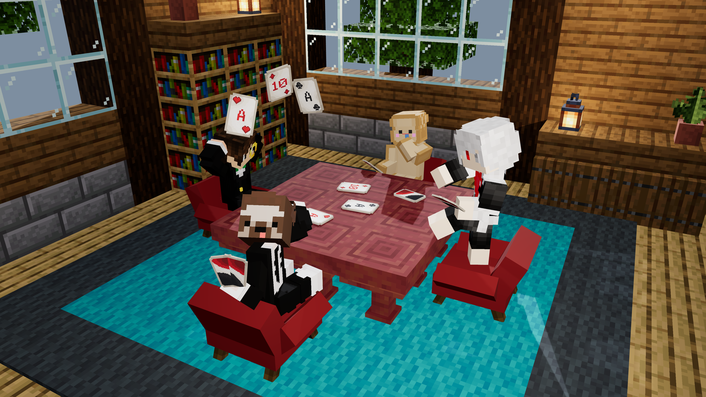
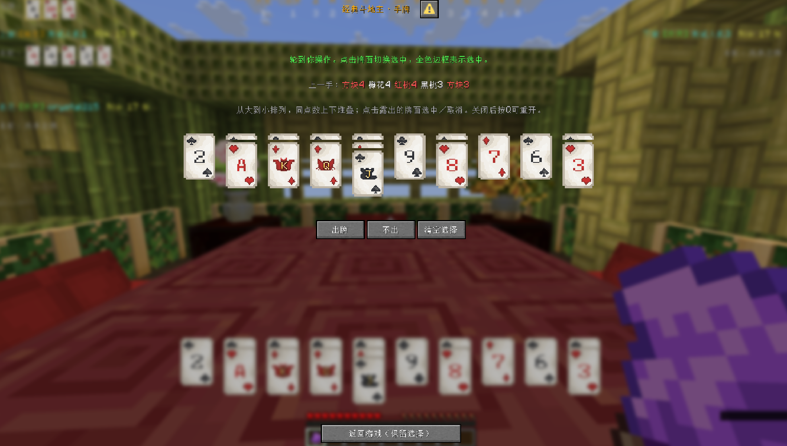
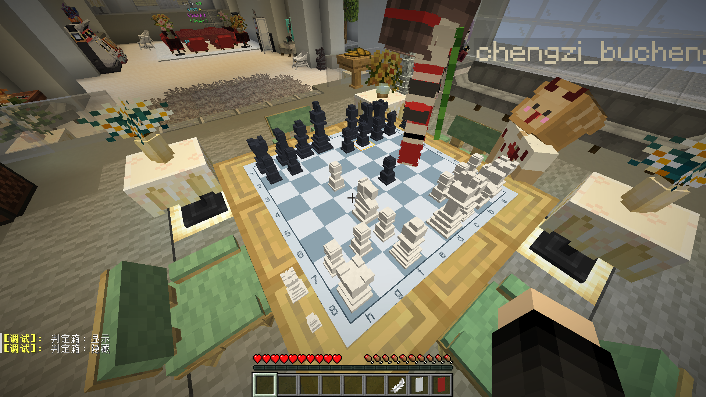
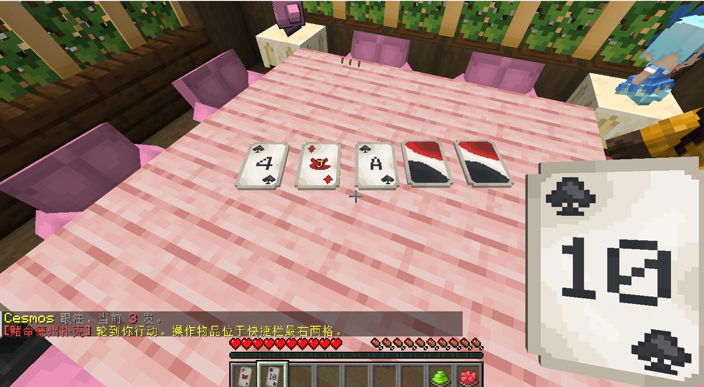

<FeatureHead
  title="Fimel Card：把桌游聚会搬进 Minecraft"
  authorName="歪浪Ylong"
  :extraAuthors="['水晶Cesmos']"
  cover="../_asset/6/cover.png"
  resourceLink="https://studiofimel.com/#/works/fimel-card"
/>

> 摘要：这是一个原版卡牌桌游数据包，现已将二十三款棋牌与聚会游戏一并收录进本作。安装数据包和配套资源包后，无需额外模组，也不用更换专用地图，就能在家里、朋友的基地或服务器大厅开桌。牌桌提供四座、八座两种规格，各游戏按规则限制人数，还有七种皮肤可供选择，让生存冒险后的休息时间，也能变成一场热闹的桌游聚会。希望直接进入世界游玩的玩家，也可以前往作者站地图区，选择已经制作好的地图。

冒险归来，想和朋友换个玩法？**Fimel Card** 是一款 Minecraft Java 版卡牌桌游数据包。它可以加入已有世界，在家里、朋友的基地或服务器活动大厅创建牌桌，邀请大家入座开玩，无需更换专用地图。

目前收录 **斗地主、赌命德州扑克、谍报风云、花火、出包魔法师、瞎掰王、问非所答、骷髅牌、临界点、Fast Card、UNO、国际象棋、中国象棋、五子棋、飞行棋、围棋、阿瓦隆、情书、掼蛋、命悬一线、卡坦岛、璀璨宝石、胡闹运动会**，共二十三种玩法。

牌桌提供四座、八座两种规格，各游戏按自身规则限制人数。入座后，通过桌边菜单选择游戏、调整设置、查看规则、开始游戏。七种牌桌皮肤可供选择，部分家具采用了 **16bit 制作组的 NyaaWork 喵工坊**资源；内置的表情包与趣味语音，也能与朋友们友好互动。

游玩时需要配套安装对应版本的数据包与资源包，相关前置功能已内置，无需额外模组。项目提供 1.21.11、26.1 系列、26.2 和 26.3 的适配包，具体安装方式与人数要求见发布页。我们还在持续完善各项玩法，欢迎带上朋友体验，也欢迎反馈遇到的问题。

不想安装，希望直接进入世界游玩的玩家，也可以前往我们的[地图区](https://studiofimel.com/#/works?type=java)，选择专为牌桌制作的地图。

感谢[文本动画库](https://space.bilibili.com/648638421)、[BetterTitle](https://github.com/Huoyuyuyu/BetterTitle)、[SK Firework](https://space.bilibili.com/1546917549)及相关前置作者，以及 16bit 制作组的 [NyaaWork 喵工坊](https://space.bilibili.com/2907002)。相关资源归原作者所有，来源与署名见项目文档。

- 发布介绍与下载：[https://studiofimel.com/#/works/fimel-card](https://studiofimel.com/#/works/fimel-card)
- 项目源码：[数据包](https://github.com/FimelStudio/fimelcard-dp) · [资源包](https://github.com/FimelStudio/fimelcard-rp)
